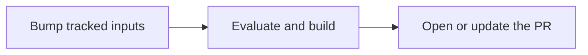

# Update Flake Inputs

Pull requests that bump `flake.lock`, opened only after a successful build of the updated flake.

**Requirements:**

- A task with an outbound Git host integration, see [Connect GitHub](github.md), [Connect Gitea or Forgejo](gitea.md) or [Connect GitLab](gitlab.md)
- A **Polling** or **Time (cron)** trigger, for the update interval

## 1. Track the Inputs

=== "UI"

    On the task, go to **Settings -> Flake Inputs -> New Override**. Fill in the **Input Name** and turn on **Force update using the URL declared in flake.nix**.

=== "Declarative"

    ```nix
    services.gradient.state.tasks.web-app.flake_input_overrides = {
      nixpkgs.keep_url = true;
      "home-manager*".keep_url = true; # (1)!
    };
    ```

    1.  `*` and `?` act as wildcards across input names. A bare `*` tracks every input.

Supported input types: `github`, `gitlab` and `git`, including `git` over SSH with the project's SSH key.

!!! warning
    An override with a **URL** pins that input at the given address. The pin blocks every update run of the task. No pull request can land while the pin is in place.

## 2. Add the PR Action

=== "UI"

    On the task, go to **Actions -> New Action**. Select **PR** as the type and choose the **Outbound Integration**. Default settings work for most repositories.

=== "Declarative"

    ```nix
    services.gradient.state.tasks.web-app.actions = [{
      name = "flake-update";
      type = "open_pr";
      config.integration = "github-acme";
    }];
    ```

| Field | Default | Effect |
|---|---|---|
| Granularity | `per_run` | With `per_input`, one pull request gets opened per input rather than a single one for all inputs |
| Verify Gate | `build` | With `eval` or `none`, the pull request opens after evaluation of the updated flake, before builds complete |
| Branch Pattern | `gradient/flake-lock-update` | With `per_input`, `{input}` must appear in the pattern |
| Title Template | `flake.lock: update <inputs>` | Accepts the placeholders `{input}`, `{inputs}`, `{count}` |
| Body Template | Old and new revision for each input | Accepts the same placeholders as the title |
| Update existing PR | on | An open pull request gets refreshed instead of a second one being opened |

## Update Run

Every trigger fire and every click on **Start Evaluation** launches an update evaluation in addition to the normal one.



- Gradient force-pushes the branch as a single commit on top of the current base.
- The pull request never falls behind.
- An unchanged `flake.lock` leads to no pull request.
- A failed build with the default `build` check blocks pull request creation.

## Verify Deployment

- A second evaluation of the update can be triggered with **Start Evaluation** in the task.
- After the evaluation, the pull request on the Git host will list the old and new revision of each input.

## Next Steps

- [Notify with Actions](actions.md): send mail and web requests when an update fails
- [Projects and Tasks](../concepts/projects-and-tasks.md): how triggers and actions work together
