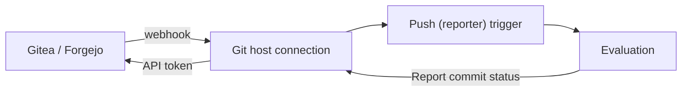

<!--
SPDX-FileCopyrightText: 2026 Wavelens GmbH <info@wavelens.io>
SPDX-License-Identifier: AGPL-3.0-only
-->

# Connect Gitea or Forgejo

Pushes and pull requests trigger evaluations. Commit statuses appear back on the Git host.

**Requirements:**

- A task with a repository URL pointing to the Gitea or Forgejo instance, see [First Project](../get-started/first-project.md)
- Admin rights on the Gitea or Forgejo instance, or on the repository's owner, so a bot account can be created

## Git Host Connections

A Git host connection can store credentials for one Git host. Each task can select one connection on its **Repository** page.



| Switch | Holds | Covers | When off |
|---|---|---|---|
| **Receives events** | Webhook secret, allowed source IPs | Evaluations on push, pull request and release. `/gradient` comment commands | Git host events never reach Gradient |
| **Reports status** | Base URL, access token of a bot account | Commit statuses. Reactions to `/gradient` comments. Writer check of pull request authors. [Flake update](flake-updates.md) pull requests | No status on commits. `/gradient` comments ignored. All pull request authors count as non-writers |

| Owner | Created in | Used by |
|---|---|---|
| Project | **Project settings -> Git host connections** | Tasks of the project |
| Team | Team settings, tab **Git host connections** (team admins) | Tasks of every project the team owns |
| Instance | **Admin**, tab **Git hosts** (instance admins) | Tasks of every project |

- Webhook URL `/api/v1/hooks/<connection-id>` can receive events for all tasks with that connection. Events map to tasks by the `owner/repo` part of the repository URL.
- Calls to the Git host act as the token account. Statuses and comments appear under that account name.
- The writer check and comment reactions use the Git host connection of the task.

## 1. Create a Bot Account

Gitea and Forgejo tie tokens to individual users. A dedicated bot account keeps statuses and comments apart from personal accounts.

| Repository owner | Access for the bot account |
|---|---|
| User | In each repository, open **Settings -> Collaborators** and grant the **Admin** permission |
| Organization | Make the bot a member of a team with **Administrator Access** to the repositories |

Gitea and Forgejo only answer permission queries for repository admins, so the writer check on pull request authors needs admin rights. Tasks without a **Pull Request (reporter)** trigger work with **Write** access alone.

The token needs these scopes.

| Scope | Needed for |
|---|---|
| `write:repository` | Commit statuses, the writer check, flake update branches and pull requests |
| `write:issue` | Reactions and replies on pull request comments |
| `read:user` | Commit author of flake update commits |

=== "UI"

    Sign in as the bot account and open **Settings -> Applications -> Generate New Token**. Pick **Repository and Organization Access** **All** for private repositories, then the scopes above.

=== "CLI"

    ```sh
    # on the Gitea host, as the Gitea service user (forgejo instead of gitea for Forgejo)
    gitea admin user create --username gradient-bot \
      --email gradient-bot@example.com --random-password
    gitea admin user generate-access-token --username gradient-bot \
      --token-name gradient --scopes write:repository,write:issue,read:user --raw
    ```

## 2. Connect the Repository

1. Open **Project settings -> Git host connections** and add a connection. Use the team settings tab **Git host connections** instead to share it with every project of the team. Select Gitea or Forgejo, enter the base URL and paste the bot token. Keep **Receives events** on, turn on **Reports status** and save. Gradient shows the webhook URL and secret once.

2. Click **Connect repository** in the project. Enter the repository URL. Follow the steps, then click **Create task**.

3. Open the **Settings -> Repository** page for the task. Select the connection in **Git host connection**, turn on **Report commit status** and save. Gradient can reject a connection when the host and the repository URL differ. **Test status report** can post a `pending` status to the latest evaluated commit.

4. Add the recommended push trigger and pull request trigger on the Triggers page for the task.

The task **Repository** page can show the **Install webhook** and **Install deploy key** buttons for a token with admin rights. Add the webhook URL and secret in the Git host's **Settings -> Webhooks -> Add Webhook** for a token without admin rights.

| Field | Value |
|---|---|
| Target URL | The webhook URL |
| HTTP method, content type | `POST`, `application/json` |
| Secret | The secret |
| Trigger on | Custom events: **Push**, **Pull Request**, **Issue Comment**, **Pull Request Comment**, **Pull Request Review**, **Release** |

Add the deploy key from step **Access** under **Settings -> Deploy Keys** for repository URLs over SSH without **Install deploy key**. Then click **Test access**.

## OAuth2 Connection

The administrator can register Gradient once as an OAuth2 application on a Gitea or Forgejo instance. Project members can then connect a Git host without pasting a token.

1. Open the **Settings -> Applications -> OAuth2 Applications** of the user or organization on the Git host.
2. Set the redirect URI to `https://gradient.example.com/api/v1/git-host-connections/oauth/callback` and create a confidential client. Save the client secret to a file.
3. Configure Gradient on NixOS.

```nix
services.gradient.giteaApp = {
  enable = true;
  instanceBaseUrl = "https://codeberg.org";
  gitHostType = "forgejo"; # (1)!
  clientId = "3f1b6c2a-9d4e-4a7b-8c1d-2e5f7a9b0c13";
  clientSecretFile = "/run/secrets/gitea-oauth-client-secret";
};
```

1.  `gitea` for Gitea.

Project members:

1. Open **Git host connections** in the project. Click **Connect with Forgejo (codeberg.org)**.
2. Enter a name and click **Continue**. Approve access on the Git host.
3. Gradient created a connection with this name. That connection can receive webhooks and report commit status. The browser returned to the connection page of the Git host.

- Forgejo and Gitea don't add scopes to OAuth2 tokens. An OAuth2 token can access the full account that approved it. Approve the token with the bot account from Step 1.
- Gradient can refresh access tokens automatically. A connection can show **Automatic refresh of the token**. Enter a token in **Edit** to replace the OAuth2 token and end the refresh.
- Gradient can link a new connection to project tasks on the same Git host that don't have a connection yet. Gradient can install webhooks on those repositories. The account for authorization must have admin rights on each repository.
- A Gradient server can have at most one OAuth2 application, so only one Gitea or Forgejo instance can use this connection.

## Declarative Setup

```nix
services.gradient.state.git_host_connections.gitea = {
  owner = "project/acme"; # (1)!
  git_host_type = "gitea"; # (2)!
  secret_file = "/run/secrets/gitea-webhook-secret"; # (3)!
  base_url = "https://gitea.example.com"; # (4)!
  access_token_file = "/run/secrets/gitea-token"; # (5)!
  reports_status = true;
  created_by = "alice";
};
```

1.  `team/<name>` can share connections with all projects of the team. `instance` can share connections with all projects.
2.  `forgejo` for Forgejo.
3.  Any random string, e.g. `openssl rand -hex 32`. Set the same value in the Git host webhook.
4.  Base URL of the Git host, without `/api/v1`.
5.  The bot's token from above, as the only content of the file.

Connection pages show webhook URL `https://gradient.example.com/api/v1/hooks/<connection-id>`. Project connections also accept old URL `https://gradient.example.com/api/v1/hooks/gitea/acme/gitea` (for Forgejo, `forgejo` instead of `gitea`).

Declared tasks come with no trigger and no connection. Set both on each task.

```nix
services.gradient.state.tasks.app = {
  project = "acme";
  repository = "https://gitea.example.com/acme/app.git";
  created_by = "alice";
  git_host_connection = "gitea"; # (1)!
  report_status = true; # (2)!
  triggers = [
    { type = "reporter_push"; } # (3)!
    { type = "reporter_pull_request"; } # (4)!
  ];
};
```

1.  The connection name, looked up in the project, then its owner team, then the instance.
2.  Posts commit statuses through the connection.
3.  Put branch and tag filters into `config`, see [Trigger Types](../reference/state.md#trigger-types).
4.  Optional. Covers evaluations of pull requests. Fork pull requests stay pending until a maintainer gives approval.

## Verify Deployment

- An evaluation starts within seconds after a push.
- The Git host reports `200` for each webhook delivery.
- The Git host shows a commit status from Gradient.

## Pull Requests

| Git host action | Result |
|---|---|
| Open or update a pull request | The head commit of the pull request get evaluated |
| Comment `/gradient run` | A new evaluation of the pull request start |
| Comment `/gradient approve` or approve the review | A pull request from a fork that waited for maintainer approval get released |
| Comment `/gradient summary` | One comment with the built, failed and unchanged packages, updated after every push |

The **Pull Request (reporter)** trigger include a setting called **Require maintainer approval for PRs from non-writers** (`require_approval` in `config`). This setting controls the approval check.

Pull requests from the [AGit flow](https://docs.gitea.com/usage/issues-prs/agit/) (`git push origin HEAD:refs/for/main`) get evaluated too.

- Read access is enough for such a push. These pull requests wait for approval the same way fork pull requests do, unless a repository writer pushed them.
- Branch filters match the AGit topic on Forgejo and `refs/pull/<number>/head` on Gitea.

Only repository writers can send `/gradient` commands. Accepted commands receive a 👀 reaction, rejected ones a 😕.

## Troubleshooting

| Symptom | Fix |
|---|---|
| `401` in the Git host's delivery log | The secrets on the two sides differ, or the connection has none. Re-enter the secret on both sides (**Edit -> Webhook Secret** on the connection in Gradient) |
| `403 forbidden_source_ip` | Add the Git host's address to the connection's allowed source IPs |
| `404` | The webhook URL names a wrong connection, or the connection has **Receives events** off |
| `200`, but no evaluation | No task with a matching trigger uses this connection, or no task repository URL matches |
| No status on the commit | **Report commit status** is off on the task's **Repository** page, or the token lacks `write:repository`. **Test status report** shows the Git host's answer |
| 😕 on a maintainer's `/gradient` comment | The bot account lack admin access to the repository |

## Next Steps

- [Actions](actions.md) - send mail, make web requests and open flake update pull requests
- [Declarative State](../reference/state.md) - every option for tasks, triggers and actions
- [Connect GitLab](gitlab.md) - the same setup, adapted for GitLab
