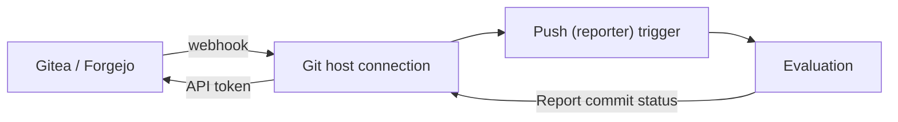

<!--
SPDX-FileCopyrightText: 2026 Wavelens GmbH <info@wavelens.io>
SPDX-License-Identifier: AGPL-3.0-only
-->

# Connect Gitea or Forgejo

Pushes and pull requests trigger evaluations. Commit statuses appear back on the Git host.

**Requirements:**

- A task with a repository URL pointing to the Gitea or Forgejo instance, see [First Project](../get-started/first-project.md)
- Admin rights on the Gitea or Forgejo instance, or on the repository's owner, so a bot account can be created

## Git Host Connections

A Git host connection can store credentials for one Git host. Each task can select one connection on its **Repository** page.



| Switch | Holds | Covers | When off |
|---|---|---|---|
| **Receives events** | Webhook secret, allowed source IPs | Evaluations on push, pull request and release. `/gradient` comment commands | Git host events never reach Gradient |
| **Reports status** | Base URL, access token of a bot account | Commit statuses. Reactions to `/gradient` comments. Writer check of pull request authors. [Flake update](flake-updates.md) pull requests | No status on commits. `/gradient` comments ignored. All pull request authors count as non-writers |

| Owner | Created in | Used by |
|---|---|---|
| Project | **Project settings -> Git host connections** | Tasks of the project |
| Team | Team settings, tab **Git host connections** (team admins) | Task in a team project with a repository grant |
| Instance | **Administration -> Git host connections** (instance admins) | Tasks with a grant for their own repository |

- Both switches sit under **Advanced** in the connection dialog. A connection with an access token has **Reports status** on by default.
- A new project connection can link project tasks on the same host that don't have a connection yet.
- Team connections and instance connections need a [repository grant](../concepts/projects-and-tasks.md#repository-grants) for each project and repository. Team admins can grant team connections. Superusers can grant instance connections.
- All Gitea and Forgejo connections need a base URL. Tasks can't use a connection without a base URL.
- Edits that change the host type or the scheme, host, or port of the base URL delete the stored access token and webhook secret. Tokens or secrets entered in the same edit remain.
- Enter the access token again after that edit. A connection from sign-in needs a new sign-in. Install the webhook again or set a new secret.
- A connection with **Receives events** on gets a new webhook secret if such an edit does not contain a secret. Gradient shows the new secret once. The webhook on the Git host needs the new secret.
- Connections with **Reports status** on reject such edits without a new access token.
- Webhook URL `/api/v1/hooks/<connection-id>` can receive events for all tasks with that connection. Events map to tasks by the `owner/repo` part of the repository URL.
- Calls to the Git host act as the token account. Statuses and comments appear under that account name.
- The writer check and comment reactions use the Git host connection of the task.

## 1. Create a Bot Account

Gitea and Forgejo tie tokens to individual users. A dedicated bot account keeps statuses and comments apart from personal accounts.

| Repository owner | Access for the bot account |
|---|---|
| User | In each repository, open **Settings -> Collaborators** and grant the **Admin** permission |
| Organization | Make the bot a member of a team with **Administrator Access** to the repositories |

Gitea and Forgejo only answer permission queries for repository admins, so the writer check on pull request authors needs admin rights. Tasks without a **Pull Request (reporter)** trigger work with **Write** access alone.

The token needs these scopes.

| Scope | Needed for |
|---|---|
| `write:repository` | Commit statuses, the writer check, flake update branches and pull requests |
| `write:issue` | Reactions and replies on pull request comments |
| `read:user` | Commit author of flake update commits |

=== "UI"

    Sign in as the bot account and open **Settings -> Applications -> Generate New Token**. Pick **Repository and Organization Access** **All** for private repositories, then the scopes above.

=== "CLI"

    ```sh
    # on the Gitea host, as the Gitea service user (forgejo instead of gitea for Forgejo)
    gitea admin user create --username gradient-bot \
      --email gradient-bot@example.com --random-password
    gitea admin user generate-access-token --username gradient-bot \
      --token-name gradient --scopes write:repository,write:issue,read:user --raw
    ```

## 2. Connect the Repository

1. Open **Project settings -> Git host connections** and click **New connection**. On the team settings page for **Git host connections**, share the connection with all projects in the team.
2. In **Host type**, select Gitea or Forgejo. Enter **Host URL**. Paste the bot token into **Access token** and click **Create**.
3. Gradient checked the token and named the bot account in "Signed in as gradient-bot". The **Webhook URL** and **Webhook secret** appear a single time.
4. Click **Connect repository** in the project and enter the repository URL. The **Git Host** step can pick the single fitting connection for the repository host. Two or more fitting connections come with a **Connection** select.
5. Follow the steps and click **Create task**. Gradient turned on **Report commit status** for the connection that has **Reports status** on.

Steps from Connection to Commit Status map to one section each on the **Repository** page of a task. A status and one action appear in each section.

| Section | Actions |
|---|---|
| **Connection** | Choose another fitting connection. If no connection matches, use **New connection** |
| **Incoming Events** | **Install webhook** for tokens with admin permissions. **Add trigger** for the recommended push and pull request triggers. |
| **Commit Status** | Turn **Report commit status** on or off. **Test the status report** can post a `pending` status to the latest evaluated commit. |

Tokens without admin rights need manual webhook setup. Open **Settings -> Webhooks** on the Git host from **Open webhook settings**. Add the webhook with these values.

| Field | Value |
|---|---|
| Target URL | The webhook URL |
| HTTP method, content type | `POST`, `application/json` |
| Secret | The secret |
| Trigger on | Custom events: **Push**, **Pull Request**, **Issue Comment**, **Pull Request Comment**, **Pull Request Review**, **Release** |

Add the deploy key from step **Repository Access** under **Settings -> Deploy Keys** for repository URLs over SSH without **Install deploy key**. Then click **Test access**.

## OAuth2 Connection

The administrator can register Gradient once as an OAuth2 application on a Gitea or Forgejo instance. Project members can then connect a Git host without pasting a token.

1. Open the **Settings -> Applications -> OAuth2 Applications** of the user or organization on the Git host.
2. Set the redirect URI to `https://gradient.example.com/api/v1/git-host-connections/oauth/callback` and create a confidential client. Save the client secret to a file.
3. Configure Gradient on NixOS.

```nix
services.gradient.giteaApp = {
  enable = true;
  instanceBaseUrl = "https://codeberg.org";
  gitHostType = "forgejo"; # (1)!
  clientId = "3f1b6c2a-9d4e-4a7b-8c1d-2e5f7a9b0c13";
  clientSecretFile = "/run/secrets/gitea-oauth-client-secret";
};
```

1.  `gitea` for Gitea.

Project members:

1. Open **Git host connections** in the project. Click **New connection**.
2. Click **Sign in with Forgejo (codeberg.org)** in the dialog. Approve access on the Git host.
3. Gradient created a connection named after the host. That connection can receive webhooks and report commit status. The browser returned to **Git host connections** of the project.

- Forgejo and Gitea don't add scopes to OAuth2 tokens. An OAuth2 token can access the full account that approved it. Approve the token with the bot account from Step 1.
- Gradient can refresh access tokens automatically. A connection can show **Automatic refresh of the token**. Enter a token in **Edit** to replace the OAuth2 token and end the refresh.
- Gradient can link a new connection to project tasks on the same Git host that don't have a connection yet. Gradient can install webhooks on those repositories. The account for authorization must have admin rights on each repository.
- A Gradient server can have at most one OAuth2 application, so only one Gitea or Forgejo instance can use this connection.

## Declarative Setup

```nix
services.gradient.state.git_host_connections.gitea = {
  owner = "project/acme"; # (1)!
  git_host_type = "gitea"; # (2)!
  secret_file = "/run/secrets/gitea-webhook-secret"; # (3)!
  base_url = "https://gitea.example.com"; # (4)!
  access_token_file = "/run/secrets/gitea-token"; # (5)!
  reports_status = true;
  created_by = "alice";
};
```

1.  `team/<name>` or `instance` share a connection with the granted repositories of other projects. Declared tasks get that permission from the state file.
2.  `forgejo` for Forgejo.
3.  Any random string, e.g. `openssl rand -hex 32`. Set the same value in the Git host webhook.
4.  Base URL of the Git host (without `/api/v1`). Tasks need it to use this connection.
5.  The bot's token from above, as the only content of the file.

Connection pages show webhook URL `https://gradient.example.com/api/v1/hooks/<connection-id>`. Project connections also accept old URL `https://gradient.example.com/api/v1/hooks/gitea/acme/gitea` (for Forgejo, `forgejo` instead of `gitea`).

Declared tasks have no trigger and no connection. Set both for each task. Declarative state can never choose a connection or link one on its own. Declared values always take precedence.

```nix
services.gradient.state.tasks.app = {
  project = "acme";
  repository = "https://gitea.example.com/acme/app.git";
  created_by = "alice";
  git_host_connection = "gitea"; # (1)!
  report_status = true; # (2)!
  triggers = [
    { type = "reporter_push"; } # (3)!
    { type = "reporter_pull_request"; } # (4)!
  ];
};
```

1.  The connection name, looked up in the project, then its owner team, then the instance.
2.  Posts commit statuses through the connection.
3.  Put branch and tag filters into `config`, see [Trigger Types](../reference/state.md#trigger-types).
4.  Triggers are optional. Pull requests get an evaluation. Commits in pull requests from forks wait for maintainer approval.

## Verify Deployment

- An evaluation starts within seconds after a push.
- The Git host reports `200` for each webhook delivery.
- The Git host shows a commit status from Gradient.

## Pull Requests

| Git host action | Result |
|---|---|
| Open or update a pull request | The head commit of the pull request get evaluated |
| Comment `/gradient run` | Gradient can start a new evaluation of the head commit. Gradient does not start an evaluation for a fork pull request while maintainer approval is on, even when its author can push. The reply comments from Gradient contain `/gradient run <commit>` for the head commit. |
| Comment `/gradient approve <commit>` | Maintainers approve and evaluate that commit on a fork pull request with pending approval. Use the full 40-character hash. |
| Approve the review | Maintainers with write permission approve the commit from their latest approving review if pending approvals sit on that commit. Gradient read that commit only from the reviews API, never from the webhook. Newer reviews with a change request from that same maintainer approve nothing. Newer comments-only reviews from that maintainer keep the approval. |
| Comment `/gradient summary` | One comment with the built, failed and unchanged packages, updated after every push |
| Comment `/gradient abort` | Abort of all evaluations in progress on a pull request |

The endpoint of the review API can return 404, omit the `commit_id` or `dismissed` field, fail, or take more than 4 seconds. These cases leave the review unapproved. A dismissal of the latest approving review can block approval. A pull request with more than 500 reviews can block approval too. Next, post `/gradient approve <commit>` as a comment with the full 40-character hash.

There's a setting called **Require maintainer approval for PRs from non-writers** for the **Pull Request (reporter)** trigger (`require_approval` in `config`). Approval checks depend on this setting. New commits need a new approval.

Approvals by comment name one commit by the full 40-character hash. A `/gradient approve` comment with no commit approves the head commit only when Gradient recorded that commit at least 60 seconds before the comment. Other `/gradient approve` comments without a commit get no approval. Gradient may have recorded the head commit later, or not at all. Replies from Gradient then contain `/gradient approve <commit>` with the full hash of the head commit. New pushes need a new approval. Pull requests from forks run without project secrets, SSH keys of the project and actions of `open_pr` and `start_evaluation` if the check is off.

Pull requests from the [AGit flow](https://docs.gitea.com/usage/issues-prs/agit/) (`git push origin HEAD:refs/for/main`) get evaluated too.

- Read access is enough for such a push. These pull requests wait for approval the same way fork pull requests do, unless a repository writer pushed them.
- Branch filters match the AGit topic on Forgejo and `refs/pull/<number>/head` on Gitea.

Only repository writers can send `/gradient` commands. Accepted commands receive a 👀 reaction, rejected ones a 😕.

## Troubleshooting

| Symptom | Fix |
|---|---|
| `401` in the Git host's delivery log | The secrets on the two sides differ, or the connection has none. Re-enter the secret on both sides (**Edit -> Webhook Secret** on the connection in Gradient) |
| `403 forbidden_source_ip` | Add the Git host's address to the connection's allowed source IPs |
| `404` | The webhook URL names a wrong connection, or the connection has **Receives events** off |
| `200`, but no evaluation | No tasks with a matching trigger use this connection, or the URL of the task repository doesn't match, or the team or instance connection has no [grant](../concepts/projects-and-tasks.md#repository-grants) for the repository |
| `403 This task can't use Git host connection` on the task | Team or instance connections lack a grant to the task repository. Ask a Team Admin or Superuser for the grant |
| No status on the commit | Either **Report commit status** is off on the task's **Repository** page, or `write:repository` is missing from the token. The response from the Git host is in **Test the status report**. |
| 😕 on a maintainer's `/gradient` comment | The bot account lack admin access to the repository |

## Next Steps

- [Actions](actions.md) - send mail, make web requests and open flake update pull requests
- [Declarative State](../reference/state.md) - every option for tasks, triggers and actions
- [Connect GitLab](gitlab.md) - the same setup, adapted for GitLab
