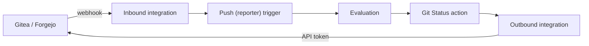

# Connect Gitea or Forgejo

Pushes and pull requests trigger evaluations. Commit statuses appear back on the Git host.

**Requirements:**

- A task with a repository URL pointing to the Gitea or Forgejo instance, see [First Project](../get-started/first-project.md)
- Admin rights on the Gitea or Forgejo instance, or on the repository's owner, so a bot account can be created

## Inbound and Outbound

Gradient exchanges data with the Git host in two directions. Each direction is a separate integration of the project.



| | Inbound | Outbound |
|---|---|---|
| Direction | Git host -> Gradient | Gradient -> Git host |
| Holds | Webhook secret, allowed source IPs | Endpoint URL, access token of a bot account |
| Picked by | **Push (reporter)** and **Pull Request (reporter)** triggers | **Git Status** and **PR** actions |
| Covers | Evaluations on push, pull request and release. `/gradient` comment commands | Commit statuses. Reactions to `/gradient` comments. Writer check of pull request authors. [Flake update](flake-updates.md) pull requests |
| Without | Git host events never reach Gradient | No status on commits. `/gradient` comments ignored. All pull request authors count as non-writers |

- The inbound integration can receive webhooks from all repositories of the project's tasks. Events match a task by the `owner/repo` part of the repository URL.
- Outbound calls act as the token's account. Statuses and comments appear under that account's name.
- Writer checks and comment reactions use the outbound integration of the task's **Git Status** action.

## 1. Create the Integrations

### Bot Account and Token

Gitea and Forgejo tie tokens to individual users. A dedicated bot account keeps statuses and comments apart from personal accounts.

| Repository owner | Access for the bot account |
|---|---|
| User | In each repository, open **Settings -> Collaborators** and grant the **Admin** permission |
| Organization | Make the bot a member of a team with **Administrator Access** to the repositories |

Gitea and Forgejo only answer permission queries for repository admins, so the writer check on pull request authors needs admin rights. Tasks without a **Pull Request (reporter)** trigger work with **Write** access alone.

The token needs these scopes.

| Scope | Needed for |
|---|---|
| `write:repository` | Commit statuses, the writer check, flake update branches and pull requests |
| `write:issue` | Reactions and replies on pull request comments |
| `read:user` | Commit author of flake update commits |

=== "UI"

    Sign in as the bot account and open **Settings -> Applications -> Generate New Token**. Pick **Repository and Organization Access** **All** for private repositories, then the scopes above.

=== "CLI"

    ```sh
    # on the Gitea host, as the Gitea service user (forgejo instead of gitea for Forgejo)
    gitea admin user create --username gradient-bot \
      --email gradient-bot@example.com --random-password
    gitea admin user generate-access-token --username gradient-bot \
      --token-name gradient --scopes write:repository,write:issue,read:user --raw
    ```

### Integrations

=== "UI"

    Open **Integrations -> New Integration** in the project twice, once per kind.

    | Kind | Fields |
    |---|---|
    | Inbound | Name, **Git Host** Gitea or Forgejo and a **Webhook Secret**. The refresh button can generate a secret. The secret is visible only once, copy it right away. Created integrations display the **Webhook URL**. |
    | Outbound | Name, **Git Host**, **Endpoint URL** (e.g. `https://gitea.example.com`, without `/api/v1`) and the bot's **Access Token** |

=== "Declarative"

    ```nix
    services.gradient.state.integrations = {
      gitea-in = {
        project = "acme";
        kind = "inbound";
        git_host_type = "gitea"; # (1)!
        secret_file = "/run/secrets/gitea-webhook-secret"; # (2)!
        created_by = "alice";
      };
      gitea-out = {
        project = "acme";
        kind = "outbound";
        git_host_type = "gitea";
        endpoint_url = "https://gitea.example.com"; # (3)!
        access_token_file = "/run/secrets/gitea-token"; # (4)!
        created_by = "alice";
      };
    };
    ```

    1.  `forgejo` for Forgejo.
    2.  Any random string, e.g. `openssl rand -hex 32`. Set the same value in the Git host webhook.
    3.  Base URL of the Git host, without `/api/v1`.
    4.  The bot's token from above, as the only content of the file.

    The webhook URL is `https://gradient.example.com/api/v1/hooks/gitea/acme/gitea-in` (`forgejo` instead of `gitea` for Forgejo).

## 2. Add the Webhook on the Git Host

In the repository or organization on the Git host, go to **Settings -> Webhooks -> Add Webhook**.

| Field | Value |
|---|---|
| Target URL | The webhook URL from step 1 |
| HTTP method, content type | `POST`, `application/json` |
| Secret | The secret from step 1 |
| Trigger on | Custom events: **Push**, **Pull Request**, **Issue Comment**, **Pull Request Comment**, **Pull Request Review**, **Release** |

A webhook limited to push events cannot deliver pull requests or the `/gradient` comment commands.

## 3. Wire the Task

A task links the two integrations. Triggers point to the inbound integration, actions to the outbound integration.

=== "UI"

    Tasks created in the UI come with a **Push (reporter)** trigger and a **Git Status** action by default. Both apply under two conditions.

    - The task came into existence after both integrations.
    - Exactly one inbound and one outbound integration exist for the repository host.

    Any other task needs both entries added manually.

    - **Triggers -> New Trigger**: add **Push (reporter)** and, for pull requests, **Pull Request (reporter)**, each bound to the inbound integration.
    - **Actions -> New Action**: add **Git Status** bound to the outbound integration.

=== "Declarative"

    Declaratively defined tasks ship without a trigger or action. Add both to the task's `triggers` and `actions` lists.

    ```nix
    services.gradient.state.tasks.app = {
      project = "acme";
      repository = "https://gitea.example.com/acme/app.git";
      created_by = "alice";
      triggers = [
        { type = "reporter_push"; integration = "gitea-in"; } # (1)!
        { type = "reporter_pull_request"; integration = "gitea-in"; } # (2)!
      ];
      actions = [
        {
          name = "report-status";
          type = "git_host_status_report";
          config.integration = "gitea-out"; # (3)!
        }
      ];
    };
    ```

    1.  The `integration` field at trigger level points to the inbound integration. Put branch and tag filters into `config`, see [Trigger Types](../reference/state.md#trigger-types).
    2.  Optional. Covers evaluations of pull requests. Fork pull requests stay pending until a maintainer gives approval.
    3.  The `config.integration` field points to the outbound integration.

## Verify Deployment

- An evaluation starts within seconds after a push.
- The Git host reports `200` for each webhook delivery.
- The Git host shows a commit status from Gradient.

## Pull Requests

| Git host action | Result |
|---|---|
| Open or update a pull request | The head commit of the pull request get evaluated |
| Comment `/gradient run` | A new evaluation of the pull request start |
| Comment `/gradient approve` or approve the review | A pull request from a fork that waited for maintainer approval get released |
| Comment `/gradient summary` | One comment with the built, failed and unchanged packages, updated after every push |

The **Pull Request (reporter)** trigger include a setting called **Require maintainer approval for PRs from non-writers** (`require_approval` in `config`). This setting controls the approval check.

Pull requests from the [AGit flow](https://docs.gitea.com/usage/issues-prs/agit/) (`git push origin HEAD:refs/for/main`) get evaluated too.

- Read access is enough for such a push. These pull requests wait for approval the same way fork pull requests do, unless a repository writer pushed them.
- Branch filters match the AGit topic on Forgejo and `refs/pull/<number>/head` on Gitea.

Only repository writers can send `/gradient` commands. Accepted commands receive a 👀 reaction, rejected ones a 😕.

## Troubleshooting

| Symptom | Fix |
|---|---|
| `401` in the Git host's delivery log | The secret on the two sides differ. Re-enter the secret on both sides (**Edit -> Webhook Secret** in Gradient) |
| `403 forbidden_source_ip` | Add the Git host's address to the integration's allowed source IPs |
| `404` | The webhook URL contain a wrong project or integration name, or the inbound integration lack a secret |
| `200`, but no evaluation | No task trigger use this integration, or no task repository URL match |
| No status on the commit | The task lack a **Git Status** action, or the token lack `write:repository` |
| 😕 on a maintainer's `/gradient` comment | The bot account lack admin access to the repository |

## Next Steps

- [Actions](actions.md) - send mail, make web requests and open flake update pull requests
- [Declarative State](../reference/state.md) - every option for tasks, triggers and actions
- [Connect GitLab](gitlab.md) - the same setup, adapted for GitLab
