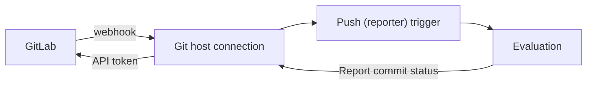

<!--
SPDX-FileCopyrightText: 2026 Wavelens GmbH <info@wavelens.io>
SPDX-License-Identifier: AGPL-3.0-only
-->

# Connect GitLab

Evaluations on every push and merge request. Commit statuses back on GitLab.

**Requirements:**

- A task with a repository URL pointing to GitLab (gitlab.com or self-hosted), see [First Project](../get-started/first-project.md)
- The Maintainer role on the GitLab project or group, for an access token

## Git Host Connections

Git host connections store credentials for one GitLab instance. Each task can select one connection on its own **Repository** page.



| Switch | Holds | Covers | When off |
|---|---|---|---|
| **Receives events** | Webhook secret, allowed source IPs | Evaluations on push, merge request and release. `/gradient` comment commands | GitLab events never reach Gradient |
| **Reports status** | Base URL, access token | Commit statuses. Reactions to `/gradient` comments. Writer check of merge request authors. [Flake update](flake-updates.md) merge requests | No status on commits. `/gradient` comments ignored. All merge request authors count as non-writers |

| Owner | Created in | Used by |
|---|---|---|
| Project | **Project settings -> Git host connections** | Tasks of the project |
| Team | Team settings, tab **Git host connections** (team admins) | Tasks of every project the team owns |
| Instance | **Admin**, tab **Git hosts** (instance admins) | Tasks of every project |

- Events for all tasks that use the connection reach the webhook URL `/api/v1/hooks/<connection-id>`. Gradient can match events to tasks by the `owner/repo` part of the repository URL.
- Calls to GitLab use the account of the token. Statuses and comments appear under that account name.
- The writer check and reactions to comments use the task's connection to its Git host.

## 1. Create an Access Token

GitLab project and group access tokens each create a bot user. A group token applies to every project in that group.

| Setting | Value |
|---|---|
| Where | **Settings -> Access tokens -> Add new token** in the GitLab project or group |
| Role | **Developer**. Writer checks count Developer and higher as writers |
| Scopes | `api` |

A personal access token from a dedicated account works as an alternative. That account needs the Developer role on each project.

## 2. Connect the Repository

1. Open **Project settings -> Git host connections** and add a connection. Use **Git host connections** on the team settings tab instead to share the connection across all team projects. Select GitLab, leave the base URL as is, and paste the token. Keep **Receives events** on. Turn on **Reports status**. Save. The webhook URL and secret appear only once.
2. Click **Connect repository** in the project. Enter the repository URL. Follow the steps and click **Create task**.
3. Open **Settings -> Repository** for the task. Select a connection in **Git host connection**. Turn on **Report commit status**. Save. Gradient can reject a connection when the host does not match the repository URL. Use **Test status report** to post a `pending` status to the latest evaluated commit.
4. Add the recommended push trigger and merge request trigger on the Triggers page for the task.

The Install webhook and Install deploy key buttons appear on the Repository page of the task for a connection token with the Maintainer role. Developer tokens need manual setup. Add the Webhook URL and secret by hand in the GitLab project or group under Settings -> Webhooks -> Add new webhook.

| Field | Value |
|---|---|
| URL | The webhook URL |
| Secret token | The secret |
| Trigger | **Push events**, **Tag push events**, **Comments**, **Merge request events**, **Releases events** |

Repository URLs over SSH with a developer token use the deploy key from the Access step. Copy that key to GitLab Settings -> Repository -> Deploy keys. Click Test access.

## Declarative Setup

```nix
services.gradient.state.git_host_connections.gitlab = {
  owner = "project/acme"; # (1)!
  git_host_type = "gitlab";
  secret_file = "/run/secrets/gitlab-webhook-secret"; # (2)!
  base_url = "https://gitlab.com"; # (3)!
  access_token_file = "/run/secrets/gitlab-token"; # (4)!
  reports_status = true;
  created_by = "alice";
};
```

1.  `team/<name>` can share connections with all projects of the team. `instance` can share connections with all projects.
2.  Any random string, e.g. `openssl rand -hex 32`. The GitLab webhook must use the same value.
3.  Base URL of GitLab, without `/api/v4`.
4.  The access token from above, as the only content of the file.

Connection pages display the Webhook URL `https://gradient.example.com/api/v1/hooks/<connection-id>`. Project connections also accept the old URL `https://gradient.example.com/api/v1/hooks/gitlab/acme/gitlab`.

Declared tasks come with no trigger and no connection. Set both on each task.

```nix
services.gradient.state.tasks.app = {
  project = "acme";
  repository = "https://gitlab.com/acme/app.git";
  created_by = "alice";
  git_host_connection = "gitlab"; # (1)!
  report_status = true; # (2)!
  triggers = [
    { type = "reporter_push"; } # (3)!
    { type = "reporter_pull_request"; } # (4)!
  ];
};
```

1.  The connection name, looked up in the project, then its owner team, then the instance.
2.  Posts commit statuses through the connection.
3.  Put branch and tag filters into `config`, see [Trigger Types](../reference/state.md#trigger-types).
4.  Optional. Covers merge request evaluations, with fork merge requests held until a maintainer approves them.

## Verify Deployment

- A push to GitLab starts an evaluation within seconds.
- The webhook logs a `200` delivery on the **Settings -> Webhooks -> Edit -> Recent events** page.
- The GitLab commit shows the pipeline status from Gradient.

## Merge Requests

| Action on GitLab | Effect |
|---|---|
| Open or update a merge request | Evaluate the head commit of that merge request |
| Comment `/gradient run` | Trigger a new evaluation of the merge request |
| Comment `/gradient approve` | Release a fork-based merge request that waits on maintainer approval |
| Comment `/gradient summary` | Post one comment with the built, failed and unchanged packages, and update it after every push |

The **Pull Request (reporter)** trigger has an option called **Require maintainer approval for PRs from non-writers** (`require_approval` in `config`). GitLab does not fire a webhook when a reviewer approves a merge request through the review UI. A `/gradient approve` comment therefore remains the only way to grant approval.

Only project members with the Developer role or higher can use `/gradient` commands. Accepted commands get a 👀 reaction, rejected ones a 😕.

## Troubleshooting

| Symptom | Fix |
|---|---|
| `401` in the webhook's recent events | The secret does not match. Re-enter it on both sides (**Edit -> Webhook Secret** in Gradient) |
| `403 forbidden_source_ip` | The connection's allowed source IPs do not include the GitLab address |
| `404` | The webhook URL names a wrong connection, or the connection has **Receives events** off |
| `200`, but no evaluation | No task with a matching trigger uses this connection, or no task repository URL matches |
| No status on the commit | **Report commit status** is off on the task's **Repository** page, or the token lacks the `api` scope or the Developer role. **Test status report** shows GitLab's answer |

## Next Steps

- [Actions](actions.md) - send mail, make web requests and open flake update merge requests
- [Declarative State](../reference/state.md) - the full reference for tasks, triggers and actions
- [Connect Gitea or Forgejo](gitea.md) - use this setup with Gitea and Forgejo as well
