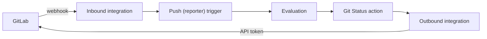

# Connect GitLab

Evaluations on every push and merge request. Commit statuses back on GitLab.

**Requirements:**

- A task with a repository URL pointing to GitLab (gitlab.com or self-hosted), see [First Project](../get-started/first-project.md)
- The Maintainer role on the GitLab project or group, for an access token

## Inbound and Outbound

Data flows between GitLab and Gradient in both directions. Each direction forms its own project integration.



| | Inbound | Outbound |
|---|---|---|
| Direction | GitLab -> Gradient | Gradient -> GitLab |
| Holds | Webhook secret, allowed source IPs | Endpoint URL, access token |
| Picked by | **Push (reporter)** and **Pull Request (reporter)** triggers | **Git Status** and **PR** actions |
| Covers | Evaluations on push, merge request and release. `/gradient` comment commands | Commit statuses. Reactions to `/gradient` comments. Writer check of merge request authors. [Flake update](flake-updates.md) merge requests |
| Without | GitLab events never reach Gradient | No status on commits. `/gradient` comments ignored. All merge request authors count as non-writers |

- One inbound integration handles webhooks from every repository used by the project's tasks. Events get matched to tasks through the `owner/repo` portion of the repository URL.
- Outbound requests run under the token's account. Statuses and comments show up under that account's name.
- Writer checks and comment reactions rely on the outbound integration tied to the task's **Git Status** action.

## 1. Create the Integrations

### Access Token

GitLab project and group access tokens each create a bot user. A group token applies to every project in that group.

| Setting | Value |
|---|---|
| Where | **Settings -> Access tokens -> Add new token** in the GitLab project or group |
| Role | **Developer**. Writer checks count Developer and higher as writers |
| Scopes | `api` |

A personal access token from a dedicated account works as an alternative. That account needs the Developer role on each project.

### Integrations

=== "UI"

    Create two integrations in the project under **Integrations -> New Integration**, one of each kind.

    | Kind | Fields |
    |---|---|
    | Inbound | Name, **Git Host** GitLab and a **Webhook Secret**. The refresh button generates a secret. The secret shows only once, so copy it immediately. Created integrations show the **Webhook URL**. |
    | Outbound | Name, **Git Host** GitLab, **Endpoint URL** (e.g. `https://gitlab.com`, without `/api/v4`) and the **Access Token** |

=== "Declarative"

    ```nix
    services.gradient.state.integrations = {
      gitlab-in = {
        project = "acme";
        kind = "inbound";
        git_host_type = "gitlab";
        secret_file = "/run/secrets/gitlab-webhook-secret"; # (1)!
        created_by = "alice";
      };
      gitlab-out = {
        project = "acme";
        kind = "outbound";
        git_host_type = "gitlab";
        endpoint_url = "https://gitlab.com"; # (2)!
        access_token_file = "/run/secrets/gitlab-token"; # (3)!
        created_by = "alice";
      };
    };
    ```

    1.  Any random string, e.g. `openssl rand -hex 32`. The GitLab webhook must use the same value.
    2.  Base URL of GitLab, without `/api/v4`.
    3.  The access token from above, as the only content of the file.

    The webhook URL is `https://gradient.example.com/api/v1/hooks/gitlab/acme/gitlab-in`.

## 2. Add the Webhook on GitLab

In the GitLab project or group, go to **Settings -> Webhooks -> Add new webhook**.

| Field | Value |
|---|---|
| URL | The webhook URL from step 1 |
| Secret token | The secret from step 1 |
| Trigger | **Push events**, **Tag push events**, **Comments**, **Merge request events**, **Releases events** |

Merge request events and the `/gradient` comment commands need their own triggers. A push-only webhook cannot deliver them.

## 3. Wire the Task

A task links the two integrations: triggers use the inbound one, actions use the outbound one.

=== "UI"

    A new task receives a **Push (reporter)** trigger and a **Git Status** action on its own. Two requirements must hold.

    - The task came into existence after both integrations.
    - Exactly one inbound and one outbound integration match the repository host.

    In all other cases, add trigger and action by hand.

    - **Triggers -> New Trigger**: add **Push (reporter)**, plus **Pull Request (reporter)** for merge requests. Each points at the inbound integration.
    - **Actions -> New Action**: add **Git Status** pointing at the outbound integration.

=== "Declarative"

    A declared task ships without any trigger or action. Define both in the task's `triggers` and `actions` lists.

    ```nix
    services.gradient.state.tasks.app = {
      project = "acme";
      repository = "https://gitlab.com/acme/app.git";
      created_by = "alice";
      triggers = [
        { type = "reporter_push"; integration = "gitlab-in"; } # (1)!
        { type = "reporter_pull_request"; integration = "gitlab-in"; } # (2)!
      ];
      actions = [
        {
          name = "report-status";
          type = "git_host_status_report";
          config.integration = "gitlab-out"; # (3)!
        }
      ];
    };
    ```

    1.  The `integration` field on the trigger names the inbound integration. Branch and tag filters belong in `config`, see [Trigger Types](../reference/state.md#trigger-types).
    2.  Optional. Covers merge request evaluations, with fork merge requests held until a maintainer approves them.
    3.  `config.integration` names the outbound integration.

## Verify Deployment

- A push to GitLab starts an evaluation within seconds.
- The webhook logs a `200` delivery on the **Settings -> Webhooks -> Edit -> Recent events** page.
- The GitLab commit shows the pipeline status from Gradient.

## Merge Requests

| Action on GitLab | Effect |
|---|---|
| Open or update a merge request | Evaluate the head commit of that merge request |
| Comment `/gradient run` | Trigger a new evaluation of the merge request |
| Comment `/gradient approve` | Release a fork-based merge request that waits on maintainer approval |

The **Pull Request (reporter)** trigger has an option called **Require maintainer approval for PRs from non-writers** (`require_approval` in `config`). GitLab does not fire a webhook when a reviewer approves a merge request through the review UI. A `/gradient approve` comment therefore remains the only way to grant approval.

Only project members with the Developer role or higher can use `/gradient` commands. Accepted commands get a 👀 reaction, rejected ones a 😕.

## Troubleshooting

| Symptom | Fix |
|---|---|
| `401` in the webhook's recent events | The secret does not match. Re-enter it on both sides (**Edit -> Webhook Secret** in Gradient) |
| `403 forbidden_source_ip` | The integration's allowed source IPs do not include the GitLab address |
| `404` | The webhook URL contains a wrong project or integration name, or the inbound integration lacks a secret |
| `200`, but no evaluation | No task trigger uses this integration, or no task repository URL matches |
| No status on the commit | The task lacks a **Git Status** action, or the token lacks the `api` scope or the Developer role |

## Next Steps

- [Actions](actions.md) - send mail, make web requests and open flake update merge requests
- [Declarative State](../reference/state.md) - the full reference for tasks, triggers and actions
- [Connect Gitea or Forgejo](gitea.md) - use this setup with Gitea and Forgejo as well
