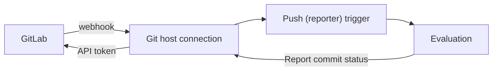

<!--
SPDX-FileCopyrightText: 2026 Wavelens GmbH <info@wavelens.io>
SPDX-License-Identifier: AGPL-3.0-only
-->

# Connect GitLab

Evaluations on every push and merge request. Commit statuses back on GitLab.

**Requirements:**

- A task with a repository URL pointing to GitLab (gitlab.com or self-hosted), see [First Project](../get-started/first-project.md)
- The Maintainer role on the GitLab project or group, for an access token

## Git Host Connections

Git host connections store credentials for one GitLab instance. Each task can select one connection on its own **Repository** page.



| Switch | Holds | Covers | When off |
|---|---|---|---|
| **Receives events** | Webhook secret, allowed source IPs | Evaluations on push, merge request and release. `/gradient` comment commands | GitLab events never reach Gradient |
| **Reports status** | Base URL, access token | Commit statuses. Reactions to `/gradient` comments. Writer check of merge request authors. [Flake update](flake-updates.md) merge requests | No status on commits. `/gradient` comments ignored. All merge request authors count as non-writers |

| Owner | Created in | Used by |
|---|---|---|
| Project | **Project settings -> Git host connections** | Tasks of the project |
| Team | Team settings, tab **Git host connections** (team admins) | Tasks of every project the team owns |
| Instance | **Administration -> Git host connections** (instance admins) | Tasks of every project |

- Both switches sit under **Advanced** in the connection dialog. **Reports status** is on by default for a connection with an access token.
- A new project connection can link the project tasks on the same host that have no connection yet.
- Events for all tasks that use the connection reach the webhook URL `/api/v1/hooks/<connection-id>`. Gradient can match events to tasks by the `owner/repo` part of the repository URL.
- Calls to GitLab use the account of the token. Statuses and comments appear under that account name.
- The writer check and reactions to comments use the task's connection to its Git host.

## 1. Create an Access Token

GitLab project and group access tokens each create a bot user. A group token applies to every project in that group.

| Setting | Value |
|---|---|
| Where | **Settings -> Access tokens -> Add new token** in the GitLab project or group |
| Role | **Developer**. Writer checks count Developer and higher as writers |
| Scopes | `api` |

A personal access token from a dedicated account works as an alternative. That account needs the Developer role on each project.

## 2. Connect the Repository

1. Open **Project settings -> Git host connections** and click **New connection**. The team settings page **Git host connections** can share the connection with every project of the team.
2. Select GitLab in **Host type**. Enter `https://gitlab.com` or the self-hosted address in **Host URL**. Paste the token into **Access token** and click **Create**.
3. Gradient checked the token and named the bot user in "Signed in as <account>". The **Webhook URL** and **Webhook secret** appear a single time.
4. Click **Connect repository** in the project and enter the repository URL. The **Git host** step can pick the single fitting connection for the repository host. A **Connection** select appears for more than one fitting connection.
5. Follow the steps and click **Create task**. Gradient turned on **Report commit status** for a connection with **Reports status** on.

The **Repository** page of the task has a section for each step from connection to commit status. Each section has a state and one action.

| Section | Actions |
|---|---|
| **Connection** | Pick another fitting connection. **New connection** when none fit |
| **Incoming events** | **Install webhook** for a token with the Maintainer role. **Add trigger** for the recommended push and merge request triggers |
| **Commit status** | **Report commit status** on or off. **Test status report** can post a `pending` status to the latest evaluated commit |

A Developer token needs a manual webhook. **Open webhook settings** can open **Settings -> Webhooks** of the GitLab project. Add a webhook with these values.

| Field | Value |
|---|---|
| URL | The webhook URL |
| Secret token | The secret |
| Trigger | **Push events**, **Tag push events**, **Comments**, **Merge request events**, **Releases events** |

Repository URLs over SSH with a developer token use the deploy key from the **Repository access** step. Copy that key to GitLab Settings -> Repository -> Deploy keys. Click Test access.

## Declarative Setup

```nix
services.gradient.state.git_host_connections.gitlab = {
  owner = "project/acme"; # (1)!
  git_host_type = "gitlab";
  secret_file = "/run/secrets/gitlab-webhook-secret"; # (2)!
  base_url = "https://gitlab.com"; # (3)!
  access_token_file = "/run/secrets/gitlab-token"; # (4)!
  reports_status = true;
  created_by = "alice";
};
```

1.  `team/<name>` can share connections with all projects of the team. `instance` can share connections with all projects.
2.  Any random string, e.g. `openssl rand -hex 32`. The GitLab webhook must use the same value.
3.  Base URL of GitLab, without `/api/v4`.
4.  The access token from above, as the only content of the file.

Connection pages display the Webhook URL `https://gradient.example.com/api/v1/hooks/<connection-id>`. Project connections also accept the old URL `https://gradient.example.com/api/v1/hooks/gitlab/acme/gitlab`.

Declared tasks come with no trigger and no connection. Set both on each task. Declarative state never picks or links a connection on its own and declared values always win.

```nix
services.gradient.state.tasks.app = {
  project = "acme";
  repository = "https://gitlab.com/acme/app.git";
  created_by = "alice";
  git_host_connection = "gitlab"; # (1)!
  report_status = true; # (2)!
  triggers = [
    { type = "reporter_push"; } # (3)!
    { type = "reporter_pull_request"; } # (4)!
  ];
};
```

1.  The connection name, looked up in the project, then its owner team, then the instance.
2.  Posts commit statuses through the connection.
3.  Put branch and tag filters into `config`, see [Trigger Types](../reference/state.md#trigger-types).
4.  Optional. Merge requests also start an evaluation. Commits in merge requests from forks wait for approval from a maintainer.

## Verify Deployment

- A push to GitLab starts an evaluation within seconds.
- The webhook logs a `200` delivery on the **Settings -> Webhooks -> Edit -> Recent events** page.
- The GitLab commit shows the pipeline status from Gradient.

## Merge Requests

| Action on GitLab | Effect |
|---|---|
| Open or update a merge request | Evaluate the head commit of that merge request |
| Comment `/gradient run` | Trigger a new evaluation of the merge request |
| Comment `/gradient approve` | Start evaluation of the commits in a merge request from a fork awaiting maintainer approval. |
| Comment `/gradient summary` | Post one comment with the built, failed and unchanged packages, and update it after every push |

The **Pull Request (reporter)** trigger has an option called **Require maintainer approval for PRs from non-writers** (`require_approval` in `config`). GitLab does not fire a webhook when a reviewer approves a merge request through the review UI. A `/gradient approve` comment therefore remains the only way to grant approval.

Only project members with the Developer role or higher can use `/gradient` commands. Accepted commands get a 👀 reaction, rejected ones a 😕.

## Troubleshooting

| Symptom | Fix |
|---|---|
| `401` in the webhook's recent events | The secret does not match. Re-enter it on both sides (**Edit -> Webhook Secret** in Gradient) |
| `403 forbidden_source_ip` | The connection's allowed source IPs do not include the GitLab address |
| `404` | The webhook URL names a wrong connection, or the connection has **Receives events** off |
| `200`, but no evaluation | No task with a matching trigger uses this connection, or no task repository URL matches |
| No status on the commit | **Report commit status** is off on the task's **Repository** page, or the token lacks the `api` scope or the Developer role. **Test status report** shows GitLab's answer |

## Next Steps

- [Actions](actions.md) - send mail, make web requests and open flake update merge requests
- [Declarative State](../reference/state.md) - the full reference for tasks, triggers and actions
- [Connect Gitea or Forgejo](gitea.md) - use this setup with Gitea and Forgejo as well
