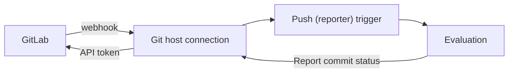

<!--
SPDX-FileCopyrightText: 2026 Wavelens GmbH <info@wavelens.io>
SPDX-License-Identifier: AGPL-3.0-only
-->

# Connect GitLab

Evaluations on every push and merge request. Commit statuses back on GitLab.

**Requirements:**

- A task with a repository URL pointing to GitLab (gitlab.com or self-hosted), see [First Project](../get-started/first-project.md)
- The Maintainer role on the GitLab project or group, for an access token

## Git Host Connections

Git host connections store credentials for one GitLab instance. Each task can select one connection on its own **Repository** page.



| Switch | Holds | Covers | When off |
|---|---|---|---|
| **Receives events** | Webhook secret, allowed source IPs | Evaluations on push, merge request and release. `/gradient` comment commands | GitLab events never reach Gradient |
| **Reports status** | Base URL, access token | Commit statuses. Reactions to `/gradient` comments. Writer check of merge request authors. [Flake update](flake-updates.md) merge requests | No status on commits. `/gradient` comments ignored. All merge request authors count as non-writers |

| Owner | Created in | Used by |
|---|---|---|
| Project | **Project settings -> Git host connections** | Tasks of the project |
| Team | Team settings, tab **Git host connections** (team admins) | Task in a team project with a repository grant |
| Instance | **Administration -> Git host connections** (instance admins) | Tasks with a grant for their own repository |

- Both switches sit under **Advanced** in the connection dialog. **Reports status** is on by default for connections with an access token.
- A new project connection can link project tasks on the same host that still have no connection.
- Team connections and instance connections need a [repository grant](../concepts/projects-and-tasks.md#repository-grants) for each project and repository. Team admins can grant team connections. Superusers can grant instance connections.
- Edits that change the host type or the scheme, host, or port of the base URL delete the stored access token and webhook secret. Tokens or secrets entered in the same edit remain.
- Enter the access token again after that edit. Install the webhook again or set a new secret.
- A connection with **Receives events** on gets a new webhook secret if such an edit does not contain a secret. Gradient shows the new secret once. The webhook on the Git host needs the new secret.
- Connections with **Reports status** on reject such edits without a new access token.
- Events for all tasks that use the connection reach the webhook URL `/api/v1/hooks/<connection-id>`. Gradient can match events to tasks by the `owner/repo` part of the repository URL.
- Calls to GitLab use the account of the token. Statuses and comments appear under that account name.
- The writer check and reactions to comments use the task's connection to its Git host.

## 1. Create an Access Token

GitLab project and group access tokens each create a bot user. A group token applies to every project in that group.

| Setting | Value |
|---|---|
| Where | **Settings -> Access tokens -> Add new token** in the GitLab project or group |
| Role | **Developer**. Writer checks count Developer and higher as writers |
| Scopes | `api` |

A personal access token from a dedicated account works as an alternative. That account needs the Developer role on each project.

## 2. Connect the Repository

1. Open **Project settings -> Git host connections** and click **New connection**. On the team settings page for **Git host connections**, share the connection with all projects in the team.
2. Select GitLab in **Host type**. Enter `https://gitlab.com` or a self-hosted address in **Host URL**. Paste the token into **Access token** and click **Create**.
3. Gradient checked the token and identified the bot user by the "Signed in as <account>" message. **Webhook URL** and **Webhook secret** only appear once.
4. Click **Connect repository** in the project and enter the repository URL. The **Git Host** step can pick the single fitting connection for the repository host. Two or more fitting connections come with a **Connection** select.
5. Follow the steps and click **Create task**. Gradient turned on **Report commit status** for the connection that has **Reports status** on.

Steps from Connection to Commit Status map to one section each on the **Repository** page of a task. A status and one action appear in each section.

| Section | Actions |
|---|---|
| **Connection** | Choose another fitting connection. If no connection matches, use **New connection** |
| **Incoming Events** | **Install webhook** for tokens with the Maintainer role. **Add trigger** for the recommended push and merge request triggers. |
| **Commit Status** | Turn **Report commit status** on or off. **Test the status report** can post a `pending` status to the latest evaluated commit. |

A Developer token needs a manual webhook. Use **Open webhook settings** to open **Settings -> Webhooks** in the GitLab project. Add a webhook with these values.

| Field | Value |
|---|---|
| URL | The webhook URL |
| Secret token | The secret |
| Trigger | **Push events**, **Tag push events**, **Comments**, **Merge request events**, **Releases events** |

Repository URLs over SSH with a developer token use the deploy key from the **Repository Access** step. Copy that key to **Settings -> Repository -> Deploy keys** in GitLab. Click **Test access**.

## Declarative Setup

```nix
services.gradient.state.git_host_connections.gitlab = {
  owner = "project/acme"; # (1)!
  git_host_type = "gitlab";
  secret_file = "/run/secrets/gitlab-webhook-secret"; # (2)!
  base_url = "https://gitlab.com"; # (3)!
  access_token_file = "/run/secrets/gitlab-token"; # (4)!
  reports_status = true;
  created_by = "alice";
};
```

1.  `team/<name>` or `instance` share a connection with the granted repositories of other projects. Declared tasks get that permission from the state file.
2.  Any random string, e.g. `openssl rand -hex 32`. The GitLab webhook must use the same value.
3.  Base URL of GitLab, without `/api/v4`.
4.  The access token from above, as the only content of the file.

Connection pages display the Webhook URL `https://gradient.example.com/api/v1/hooks/<connection-id>`. Project connections also accept the old URL `https://gradient.example.com/api/v1/hooks/gitlab/acme/gitlab`.

Declared tasks have no trigger and no connection. Set both for each task. Declarative state can never choose a connection or link one on its own. Declared values always take precedence.

```nix
services.gradient.state.tasks.app = {
  project = "acme";
  repository = "https://gitlab.com/acme/app.git";
  created_by = "alice";
  git_host_connection = "gitlab"; # (1)!
  report_status = true; # (2)!
  triggers = [
    { type = "reporter_push"; } # (3)!
    { type = "reporter_pull_request"; } # (4)!
  ];
};
```

1.  The connection name, looked up in the project, then its owner team, then the instance.
2.  Posts commit statuses through the connection.
3.  Put branch and tag filters into `config`, see [Trigger Types](../reference/state.md#trigger-types).
4.  Optional. Merge requests also start an evaluation. Commits in merge requests from forks wait for approval from a maintainer.

## Verify Deployment

- A push to GitLab starts an evaluation within seconds.
- The webhook logs a `200` delivery on the **Settings -> Webhooks -> Edit -> Recent events** page.
- The GitLab commit shows the pipeline status from Gradient.

## Merge Requests

| Action on GitLab | Effect |
|---|---|
| Open or update a merge request | Evaluate the head commit of that merge request |
| Comment `/gradient run` | A new evaluation of the head commit runs without project secrets for a merge request from a fork if the option is off. Gradient waits for approval with the option on, then answers with the command for the head commit. |
| Comment `/gradient approve <commit>` | Start the evaluation of that commit in a merge request from a fork with pending maintainer approval. Use the full 40-character hash. |
| Comment `/gradient summary` | Post one comment with the built, failed and unchanged packages, and update it after every push |

The **Pull Request (reporter)** trigger options include **Require maintainer approval for PRs from non-writers** (`require_approval` in `config`). GitLab does not fire a webhook when reviewers approve a merge request in the review UI. A `/gradient approve` comment is the only way to grant approval. Merge requests from forks always wait for this comment on open or update, even with the option off. A `/gradient run` comment with no commit can start the head commit of a merge request from a fork without the project secret when the option is off. A `/gradient approve` comment can approve only the commit with a full 40-character hash. A `/gradient approve` comment with a short hash cannot approve anything. A `/gradient approve` comment with no commit approves the head commit only when Gradient recorded that commit at least 60 seconds before the comment. Other `/gradient approve` comments without a commit don't count as approval. Gradient may have recorded the head commit later, or not at all. Replies from Gradient then contain `/gradient approve <commit>` with the full hash of the head commit. New pushes need a new approval.

Only project members with the Developer role or higher can use `/gradient` commands. Accepted commands get a 👀 reaction, rejected ones a 😕.

## Troubleshooting

| Symptom | Fix |
|---|---|
| `401` in the webhook's recent events | The secret does not match. Re-enter it on both sides (**Edit -> Webhook Secret** in Gradient) |
| `403 forbidden_source_ip` | The connection's allowed source IPs do not include the GitLab address |
| `404` | The webhook URL names a wrong connection, or the connection has **Receives events** off |
| `200`, but no evaluation | No tasks with a matching trigger use this connection, or the URL of the task repository doesn't match, or the team or instance connection has no [grant](../concepts/projects-and-tasks.md#repository-grants) for the repository |
| `403 This task can't use Git host connection` on the task | Team or instance connections lack a grant to the task repository. Ask a Team Admin or Superuser for the grant |
| No status on the commit | Either **Report commit status** is off on the **Repository** page of the task, or the token does not have the `api` scope or the Developer role. See the response from GitLab in **Test the status report**. |

## Next Steps

- [Actions](actions.md) - send mail, make web requests and open flake update merge requests
- [Declarative State](../reference/state.md) - the full reference for tasks, triggers and actions
- [Connect Gitea or Forgejo](gitea.md) - use this setup with Gitea and Forgejo as well
