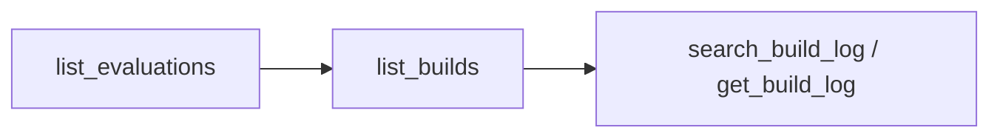

<!--
SPDX-FileCopyrightText: 2026 Wavelens GmbH <info@wavelens.io>
SPDX-License-Identifier: AGPL-3.0-only
-->

# Connect an AI Assistant

Any [Model Context Protocol](https://modelcontextprotocol.io) client, such as Claude Code, Claude Desktop or Cursor, can connect through `gradient mcp`. The connection exposes every evaluation, build and build log. An assistant can locate a failed build and read the log line that broke it.

**Requirements:**

- The CLI, see [Install](../reference/cli.md#install)

## 1. Log In

```sh
gradient login https://gradient.example.com
```

Tool calls execute with the identity of the logged-in user. Each call has access only to that user's projects. To set a default project for commands that accept one, run `gradient project select <name>`.

## 2. Add the Server to the Client

=== "Claude Code"

    ```sh
    claude mcp add gradient -- gradient mcp
    ```

=== "JSON config"

    ```json
    {
      "mcpServers": {
        "gradient": {
          "command": "gradient",
          "args": ["mcp"]
        }
      }
    }
    ```

## Verify Deployment

Ask the assistant: "Explain the last failed evaluation of `web-app`."

The assistant then works through the available tools step by step.



## Tools

| Tool | Result |
|---|---|
| `list_projects`, `list_tasks` | All projects of the user, with the tasks in each project |
| `list_evaluations`, `get_evaluation` | All evaluations of a task, each with its build count. A single evaluation includes the commit, status and error |
| `list_builds`, `get_build` | All builds of an evaluation. A single build includes the derivation, system and outputs |
| `get_build_log` | A build log, either complete or limited to a line range. Logs with more than 10 lines go into a temp file, and the tool returns the path to that file |
| `search_build_log` | All matching log lines, each with its line number |

## Control Tools

With `gradient mcp --control`, the assistant can act on CI. Project permissions still apply.

| Tool | Effect |
|---|---|
| `start_evaluation` | Start an evaluation for a task, optionally pinned to a commit |
| `abort_evaluation` | Abort all running and queued builds of an evaluation |
| `watch_evaluation` | Block until an evaluation finishes, up to `timeout_seconds` (default 600, max 3600) |

Without `--control`, the server runs in read-only mode.

## Troubleshooting

| Symptom | Fix |
|---|---|
| `Server URL not set` | Run `gradient login` before starting the client |
| Protocol errors from a wrapper script | The server sends JSON-RPC over stdout. Redirect all stderr output away from stdout |

## Next Steps

- [Evaluations and Builds](../concepts/evaluations-and-builds.md) explains the data returned by these tools.
- [CLI](../reference/cli.md) documents the remaining `gradient` commands.
