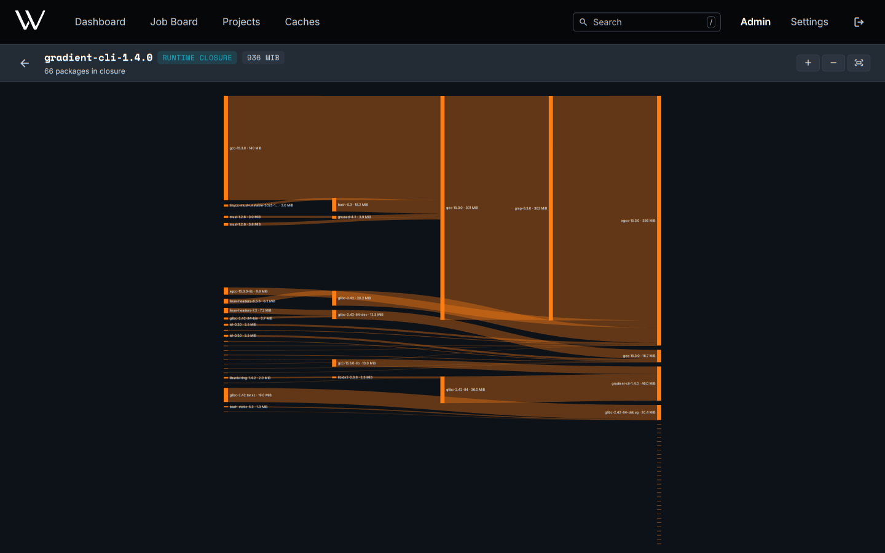

<!--
SPDX-FileCopyrightText: 2026 Wavelens GmbH <info@wavelens.io>
SPDX-License-Identifier: AGPL-3.0-only
-->

# Closure View

The Closure View show where the size of a build output originate, drawn as a Sankey diagram of the closure. Use it to trim ISOs, netboot images and container layers. Open the closure of the newest build with **View Closure** on an entry point's metrics page.

| Area | Content | Actions |
|---|---|---|
| Header | Total closure size, closure type, truncation warning | Zoom in, zoom out, fit to screen |
| Diagram | Packages as bars, flowing from dependencies on the left into the root on the right | Scroll to zoom, drag to pan |

A bar's height match the package's closure size. That size include the package's own NAR plus everything the package pulled in. The tallest bars be the best candidates to remove.

## Runtime and Build Closure

Two closure types exist:

| Closure | Contents | How to view |
|---|---|---|
| Runtime | Store paths that the outputs reference and that the system needs at runtime | Default view |
| Build | All derivations involved in building the output | Append `?type=build` to the URL |

Only outputs present in the cache can have a runtime closure.

## Large Closures

- The 500 largest packages show one by one. The rest collapse into an **others** bar under the nearest shown package.
- Packages appear under one parent only. The bars add up to the total.
- The total will stay exact, even with a truncation warning in the header.

## Related

- [Evaluations and Builds](../concepts/evaluations-and-builds.md): entry points and how the build model works
- [API](../reference/api.md#examples): closure endpoints available in scripts
