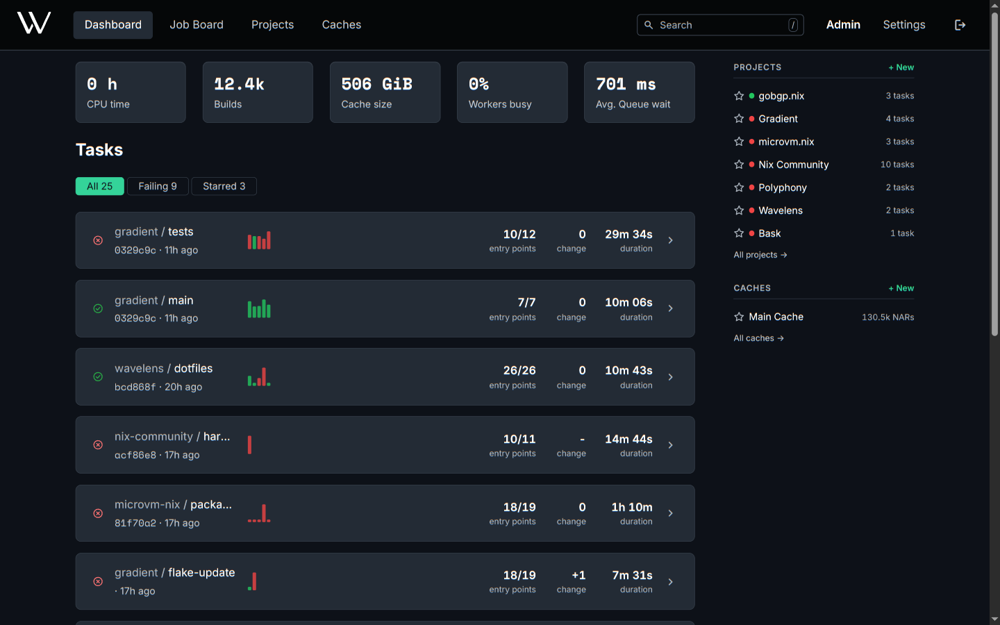

<!--
SPDX-FileCopyrightText: 2026 Wavelens GmbH <info@wavelens.io>
SPDX-License-Identifier: AGPL-3.0-only
-->

# Dashboard

The dashboard opens after sign-in. It lists every task that needs attention across all projects.

| Area | Content | Actions |
|---|---|---|
| Stats | CPU time, builds, cache size, busy workers and queue wait across the visible projects | |
| Filter | **Starred**, **All** and **Failing**, each with a count. **Starred** is the default, and hidden while no task is starred | Switch the task list. The choice stays in the URL |
| Task list | The top 10 tasks: latest commit, recent evaluations as bars, entry points ok/total, change in failures, speed | Open a task from the row, an evaluation from a bar. Page through every task with **Show all** |
| Activity | A calendar of the last year | Switch between evaluations and failures |
| Rail | Projects by rank, caches with starred first | Star a project or cache. Open its tasks |

In the task list, bar height shows the duration and bar color shows the status.

New users without projects or caches see first steps instead of the dashboard. These steps cover creating a project, adding a task, connecting a worker and creating or subscribing to a cache.

## Ranking

The task list shows two kinds of tasks: tasks from the user's projects and starred tasks from public projects. Four tiers determine the order:

1. Starred and active
2. Active
3. Starred
4. Member only

A task with an evaluation in the last 14 days other than a pull request is active. Tasks in a tier sort by their newest evaluation, newest first. Pull request evaluations contribute to the stats only.

## Stars

- Mark a project, task or cache as a star. The page header and the rail both offer this control.
- Stars stay private. Ranking and filtering apply to the user's own view only.
- Starred items appear at the top of the task list, the rail and the command palette.

## Command Palette

Open the palette with `/` from anywhere outside a text field, or with the search field in the header.

| Query | Results |
|---|---|
| A name | Projects, tasks and caches, starred first |
| 7 to 40 hex characters | Commits by hash prefix |
| A store path or NAR hash | NARs in every readable cache |
| Empty | The starred items |

Move the selection with the arrow keys or with Ctrl+J / Ctrl+K. Enter will open the selected item. Escape will close the palette.

## Related

- [Projects and Tasks](../concepts/projects-and-tasks.md) - what the task list displays
- [Evaluations and Builds](../concepts/evaluations-and-builds.md) - the statuses shown in the bars
