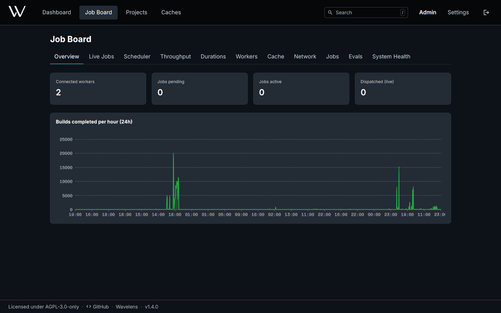
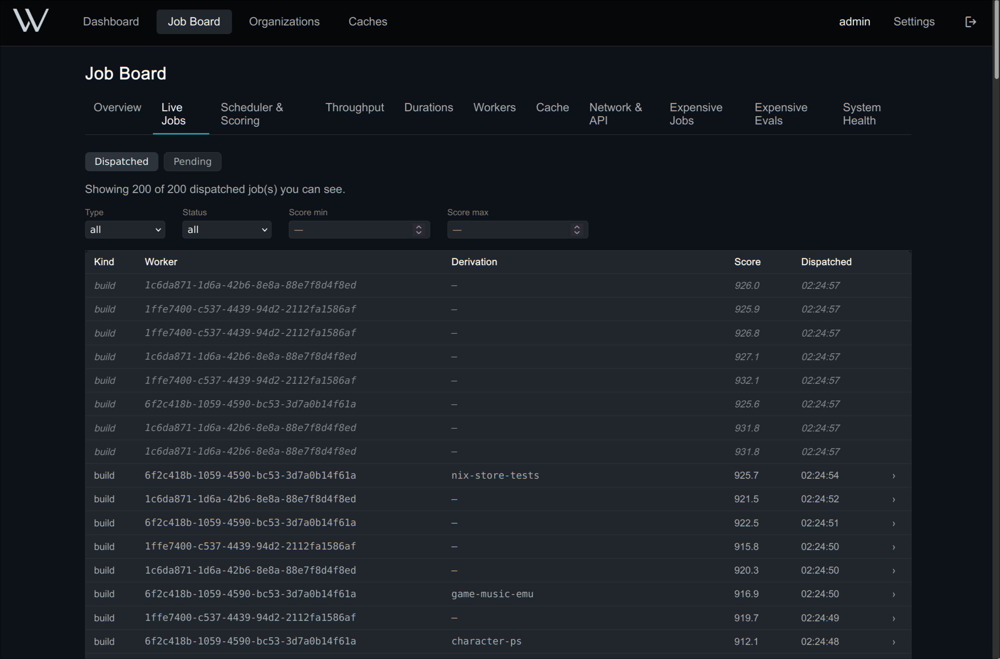
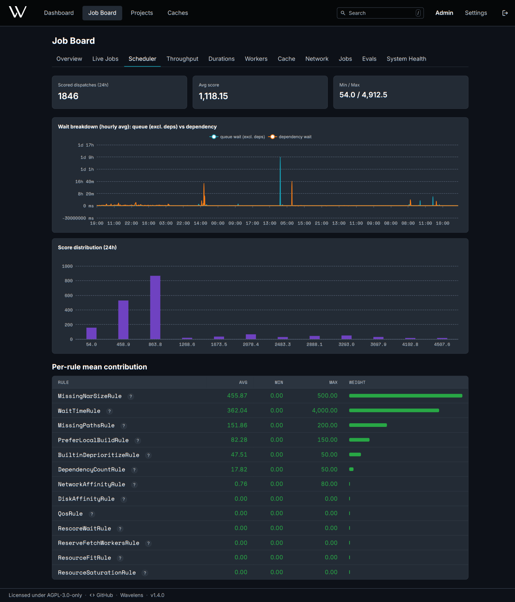
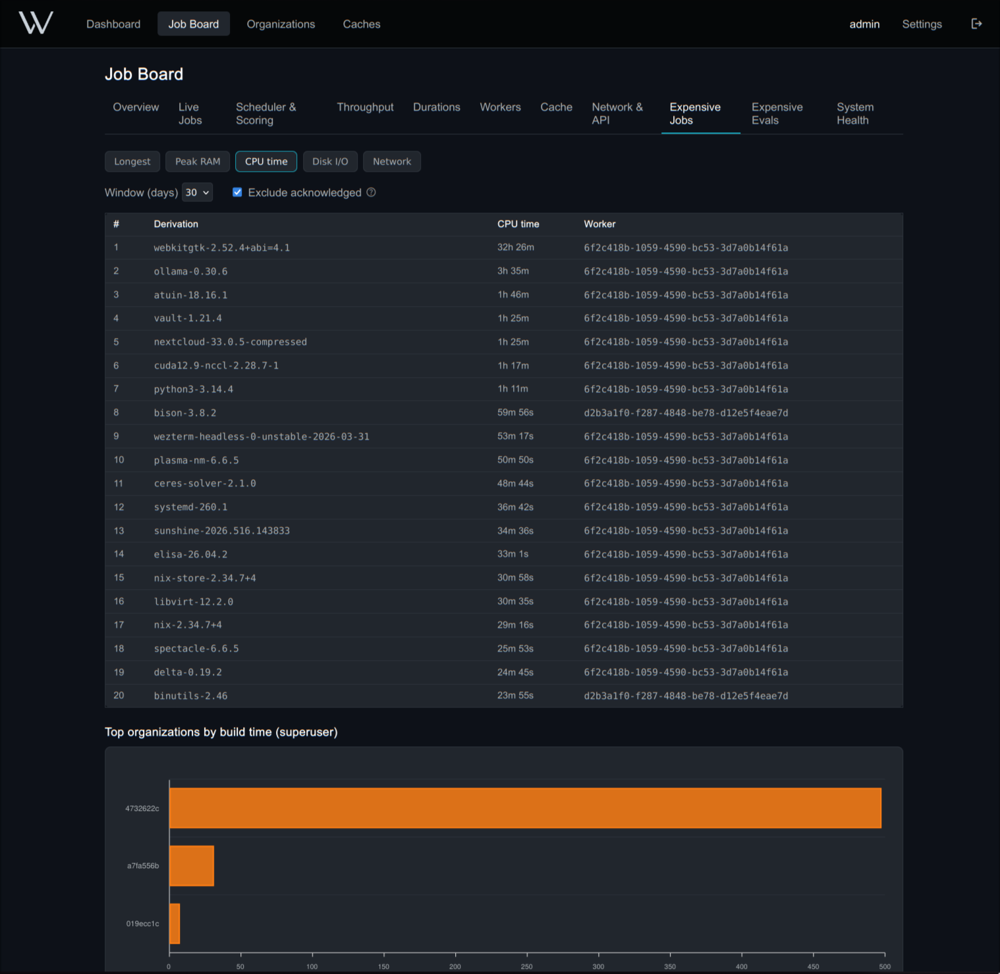
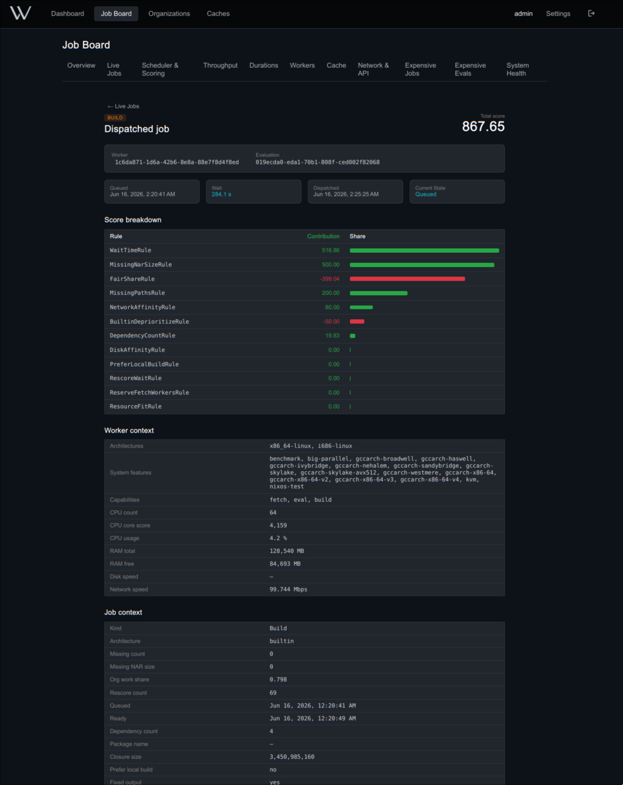
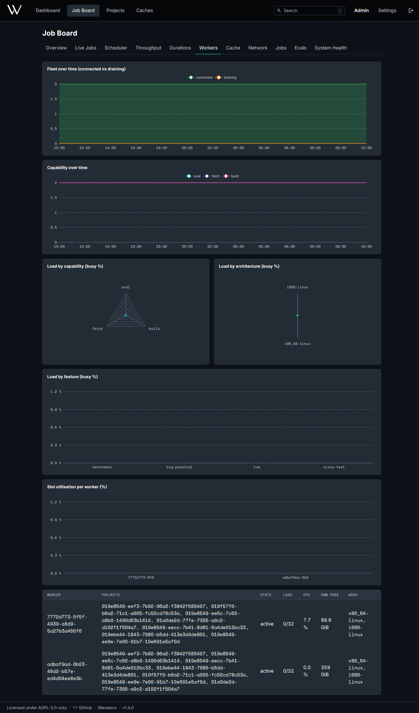

<!--
SPDX-FileCopyrightText: 2026 Wavelens GmbH <info@wavelens.io>
SPDX-License-Identifier: AGPL-3.0-only
-->

# Job Board

The **Job Board** in the header shows scheduler and worker activity, both live and historical. It covers running jobs, the reasoning behind each worker decision, fleet load and the most expensive builds.

| Tab | Content | Actions |
|---|---|---|
| Overview | Connected workers, pending and active jobs, builds per hour | |
| Live Jobs | Currently running jobs with live updates | Open a job's inspection page |
| Scheduler | Queue wait versus dependency wait, score distribution, mean contribution per scoring rule | **?** next to a rule explains that rule |
| Throughput | Builds created, completed and failed, evaluations per hour, active jobs per worker | |
| Durations | Average and maximum build time, plus the wait split over time | |
| Workers | Fleet size, load by capability, system and feature, slot use per worker | Reveal a missing worker kind |
| Cache | Stored size, traffic, growth, latency per upstream cache | |
| Storage | NAR storage latency and errors per operation (file or S3), writer lane fill and send stalls, NAR delivery queue and failures. All charts share one time axis across the whole window, minute resolution up to 6 h. Superusers only | Choose the time window |
| Network | NAR egress, worker upload, download and disk speed, HTTP latency per route | |
| Jobs | Costliest builds by wall time, peak RAM, CPU time and disk I/O | Choose the time window |
| Evals | Costliest evaluations by time, peak memory, thunks, function calls and allocations | Choose the time window |
| System Health | Server runtime, metric pipeline lag, route stats. Superusers only | **Run Deep GC**, **Enable Draining** |

=== "Live Jobs"

    

=== "Scheduler"

    

=== "Jobs"

    

Draining stops new job handouts and parks running evaluations. A server restart clears the flag. A stop without draining also stays safe: the next start re-queues interrupted work.

## Storage Metrics

The **Storage** tab pulls its data from the metric keys below. Each bucket keeps its own counts. A bucket with no events reports zero.

| Key | Labels | Unit | Chart |
|---|---|---|---|
| `storage.op_ms` | Operation: `get`, `head`, `put`, `put_part`, `multipart_create`, `multipart_complete`, `delete` | ms per call | Storage latency |
| `storage.op_errors` | `<op>/error`, `<op>/cancelled`, `read/error` | count | Storage errors |
| `proto.bulk_lane_fill` | `bulk` | peak fill 0-1, shown as % | Writer lanes |
| `proto.control_lane_fill` | `control` | peak fill 0-1, shown as % | Writer lanes |
| `proto.send_stalls` | `bulk`, `control` | count | Writer lanes (bars) |
| `nar.serves_waiting` | `waiting` | peak serves | NAR serves |
| `nar.serves_active` | `active` | peak serves | NAR serves |
| `nar.serve_failures` | `not_found`, `storage_timeout`, `storage_error`, `send_stalled` | count | NAR serves (bars) |

- A `cancelled` call is a dropped request. A timeout on a hung backend usually cut it off.
- Lane fill and send stalls cover every protocol session, worker and cache alike. A stall is a send that waited past `send_chunk_timeout` for lane capacity.
- Build log objects on S3 go through the same store and share the storage operation labels.

## Job Inspection

Open a job from **Live Jobs** to see five sections.

- The server's marks: **Queued**, **Ready**, **Assigned**, **Finished**.
- **Worker tail**: for finished jobs, the time the worker spent after its last phase.
- **Transit**: for finished jobs, the remaining time between **Assigned** and **Finished**, consumed by the network and by queues on both ends.
- The worker timeline: nested phases (fetch, evaluate, build, compress, upload wait, NAR push) with duration, share and bytes moved.
- The score breakdown: each scoring rule's contribution to the winning worker.

A slow job's timeline shows where the time went. The score explains why the server picked that worker.

**Abort** can halt a running job in any project for a superuser.

??? note "Timeline Phases"
    | Phase | Meaning |
    |---|---|
    | `fetch` | Cloning the flake source and fetching its missing flake inputs |
    | `push_inputs` | Uploading the flake source and its inputs to the cache |
    | `eval_flake` | Evaluating the flake outputs |
    | `eval_derivations` | Resolving the outputs to derivations |
    | `eval_cache_pull`, `eval_cache_push` | Waiting for and returning the shared evaluation cache |
    | `known_derivations_wait` | Waiting for the server to name the `.drv` files already known to the server |
    | `drv_closure_push` | Pushing a batch of `.drv` closures |
    | `prefetch` | Bringing a build's inputs from the cache into the local store |
    | `nar_fetch` | One round of input downloads, nested under `prefetch` |
    | `nar_import` | Importing the downloaded inputs into the local store, nested under `prefetch` |
    | `substitute_fetch` | Fetching one output from an upstream cache |
    | `download` | One `builtin:fetchurl`, fetched by the worker without Nix |
    | `build` | One derivation build |
    | `compress` | Packing the job's outputs for upload |
    | `nar_push` | Uploading a batch of NARs, nested under `compress` for outputs |
    | `cache_query_wait` | Waiting for a cache status reply |

    Jobs record at most 2000 phases. Further phases still run without individual timing.

## Workers

Each load chart shows running jobs of one kind next to the worker slots reserved for that kind. A chart close to 100% names the worker type to add: evaluation, build, a system such as `aarch64-linux`, or a feature such as `kvm`.

Per-worker CPU, memory, disk, upload and download history appear under **Project -> Workers -> Metrics**. Connection and disconnect events stay there for [`retentionDays`](../reference/configuration.md#general) (90 days by default).

## Visibility

| Viewer | Visible Scope |
|---|---|
| Superuser | Everything |
| Member | Full access to own and public projects. Other projects show infrastructure as counts only |
| Signed out | Public project totals |

The resource tabs require build metrics from the workers. Enable them with [`services.gradient.worker.build.metrics`](../reference/configuration.md#workerbuild). Retention of these metrics is configured under [metrics pipeline and retention](../reference/configuration.md#metrics).

## Related

- [Workers](../concepts/workers.md): capabilities and build matching
- [Scheduler Policies](../reference/scheduler-policies.md): the scoring rules
