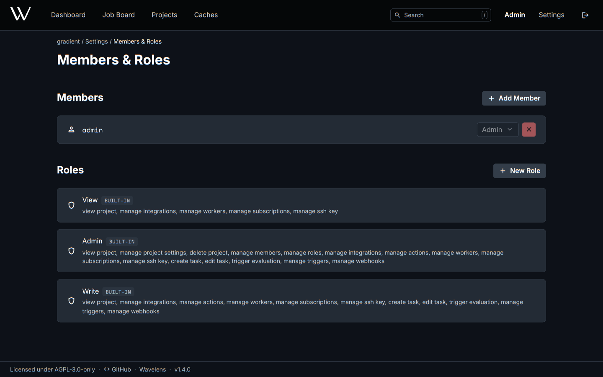

<!--
SPDX-FileCopyrightText: 2026 Wavelens GmbH <info@wavelens.io>
SPDX-License-Identifier: AGPL-3.0-only
-->

# Members and Roles

Members and roles define who can access a project or cache and what they can do there. Each project and each cache keeps its own member list. Open the page through **Settings -> Members & Roles** on a project or **Members & Roles** on a cache.

The page has three areas:

| Area | Content | Actions |
|---|---|---|
| Members | All members and their assigned role | Invite a user with **Add Member**, change a role, or remove a member |
| Pending Invitations | Invitations not yet accepted | **Revoke** |
| Roles | Built-in roles and custom roles | **New Role**: pick a name and single permissions |

## Invitations

- Use **Add Member** to send an invitation. The invitee got no access until the invitation got accepted on the **My Invites** page in the user settings.
- Each invitation expired after 7 days. One user could hold at most one open invitation per project or cache.
- With [email](../reference/configuration.md#email) configured, the invitee also got the invitation link by mail.
- A superuser with the permission could add members directly.
- Projects and caches [declared in Nix](../guides/manage-with-nix.md) took their members from the configuration alone.

## Project Roles

Each project has three roles. The table below shows what each role allows.

| Role | Can |
|---|---|
| Admin | Everything: settings, members, roles, project deletion |
| Write | Tasks, triggers, actions, evaluations, integrations, workers, webhooks, cache subscriptions, SSH key |
| View | See the project. Change workers, integrations, cache subscriptions and the SSH key |

Roles map to individual permissions. Each permission covers one area of the project.

| Permission | Scope |
|---|---|
| `viewProject` | Seeing the project and its evaluations |
| `manageProjectSettings`, `deleteProject` | Editing or deleting the project |
| `manageMembers`, `manageRoles` | Inviting members, editing custom roles |
| `manageIntegrations`, `manageWebhooks` | Git host integrations and webhooks |
| `manageWorkers`, `manageSubscriptions`, `manageSshKey` | Workers, cache subscriptions and the SSH key |
| `createTask`, `editTask` | Creating and editing tasks |
| `manageTriggers`, `manageActions` | Triggers and actions on tasks |
| `triggerEvaluation` | Starting and aborting evaluations |

## Cache Roles

Roles control what a member can do with a cache.

| Role | Can |
|---|---|
| Admin | Do everything |
| Write | See the cache, download and upload paths |
| View | See the cache and download paths |

Each role combines the permissions below.

| Permission | Scope |
|---|---|
| `viewCache` | Seeing the cache |
| `readStore`, `writeStore` | Downloading and uploading paths |
| `manageCacheSettings`, `deleteCache` | Editing or deleting the cache |
| `manageCacheKeys`, `manageUpstreamCaches` | Signing keys and upstream caches |
| `manageCacheMembers`, `manageCacheRoles` | Members and custom roles |
| `manageCacheSubscriptions` | Approving project subscriptions |
| `manageCacheWebhooks` | Cache webhooks |

## Rules

- Edit and delete of built-in roles: not possible.
- Delete a custom role only after removal of all member assignments.
- Keep at least one Admin per cache. Removal of the last Admin fails.
- Identity provider groups can supply roles. See [Set Up Single Sign-On](../guides/sso.md#3-map-groups-to-roles) for the group-to-role mapping.

## Related

- [Share a Cache](../guides/share-a-cache.md) covers subscriptions and cache members
- [Caches](../concepts/caches.md#roles) describes the roles in context
