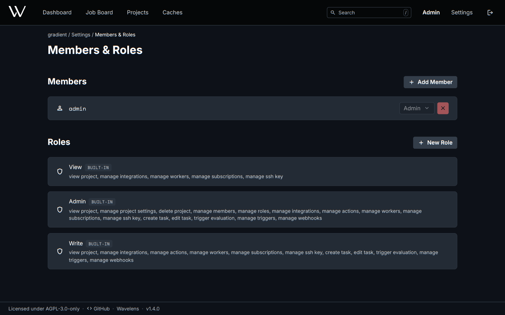

<!--
SPDX-FileCopyrightText: 2026 Wavelens GmbH <info@wavelens.io>
SPDX-License-Identifier: AGPL-3.0-only
-->

# Members and Roles

Members and roles define who can access a project, cache, or team and what each person can do there. Projects, caches, and teams each have a separate member list. Use the **Members** button in the header of a project, cache, or team page to open the page. The URL is `/project/<name>/members/people`, `/caches/<name>/members/people`, or `/team/<name>/members/people`.

- The project page and the cache page show the **Members** button to members and instance admins. Anonymous visitors and signed-in users without access don't see the button.
- Members with the `View` role see the page in read-only mode. They get no **Invite Member**, no role changes, and no **Remove**.

This page can show up to four tabs.

| Tab | Content | Actions |
|---|---|---|
| People | Every person with access, their role and the source of that access: direct role, team grant, owner team or instance administrator | Change a direct role, **Remove** |
| Teams | Projects and caches only. Teams with a grant and the role their members get | **Grant Team**, change or revoke a grant |
| Pending | Only for people who can manage members. Open invitations and team grant requests | **Revoke** |
| Roles | Projects and caches only, members only. Built-in and custom roles | **New Role**: pick a name and single permissions |

Direct roles give a person their role. Team grants apply only to people without a direct role.

## Invite Member

Use **Invite Member** to open a dialog with a username, a role, and a way to add the member.

- **Add now** can apply the role right away. Instance admins always have this option. On projects and caches, everyone who can manage members can use this option for people who already have access through team grants or owner teams.
- **Send invitation** can grant access only after acceptance of the invitation on the **Requests** page in the header user menu. Invitations expire after 7 days. A person can hold only one pending invitation per project, cache or team.
- The invited person can also receive the invitation link by email with [email](../reference/configuration.md#email) set.
- Projects and caches [declared in Nix](../guides/manage-with-nix.md) get their members from the configuration only.

## Remove a Member

The first step is a confirmation from **Remove** on the row in the People tab. Access rights that remain after removal appear in the dialog. People with team grants keep their team roles. Links to those team pages appear in the dialog as well. People who remove their own access return to the list of projects or caches.

## Grant a Team

All teams on the server appear in the Teams tab **Grant Team**. Select a team and a role for team members. The grant form can also allow team workers to build. People who are not Admin in the chosen team create a request instead of an active grant. A team Admin must approve that request first. See [Teams](../concepts/teams.md#requests).

## Your Access

Use **Settings -> Access** (`/settings/access`) to list every project, cache and team the account can access, with the reason for each.

## Revoke All Access

Instance administrators open **User access** in the user menu of `/admin/users`. Enter a username and select **View access**. This shows every project, cache, and team of that user, with the reason for each. **Revoke All Access** removes all direct roles in projects and caches of that user, all team memberships, and all pending invitations. Memberships from server settings and groups from the identity provider stay.

## Project Roles

Each project has three roles. The table below shows what each role allows.

| Role | Can |
|---|---|
| Admin | Everything: settings, members, roles, project deletion |
| Write | Tasks, triggers, actions, evaluations, Git host connections, workers, webhooks, cache subscriptions |
| View | View the project |

Roles map to individual permissions. Each permission covers one area of the project.

| Permission | Scope |
|---|---|
| `viewProject` | Seeing the project and its evaluations |
| `manageProjectSettings`, `deleteProject` | Editing or deleting the project |
| `manageMembers`, `manageRoles` | Inviting members, editing custom roles |
| `manageIntegrations`, `manageWebhooks` | Git host connections and webhooks for the project. Connection selections on a task need only `editTask`. |
| `manageWorkers`, `manageSubscriptions` | Workers and cache subscriptions |
| `manageSshKey` | Regenerate the SSH key |
| `createTask`, `editTask` | Creating and editing tasks |
| `manageTriggers`, `manageActions` | Triggers and actions on tasks |
| `triggerEvaluation` | Starting and aborting evaluations |

## Cache Roles

Roles control what a member can do with a cache.

| Role | Can |
|---|---|
| Admin | Do everything |
| Write | See the cache, download and upload paths |
| View | See the cache and download paths |

Each role combines the permissions below.

| Permission | Scope |
|---|---|
| `viewCache` | Seeing the cache |
| `readStore`, `writeStore` | Downloading and uploading paths |
| `manageCacheSettings`, `deleteCache` | Editing or deleting the cache |
| `manageCacheKeys`, `manageUpstreamCaches` | Signing keys and upstream caches |
| `manageCacheMembers`, `manageCacheRoles` | Members and custom roles |
| `manageCacheSubscriptions` | Approving project subscriptions |
| `manageCacheWebhooks` | Cache webhooks |

## Rules

- Edit and delete of built-in roles: not possible.
- Delete a custom role only after removal of all member assignments.
- Custom roles each contain `viewProject` or `viewCache`. Roles that leave one out get the missing one from the server.
- Keep at least one Admin per cache. Removal of the last Admin fails.
- Identity provider groups can supply roles. See [Set Up Single Sign-On](../guides/sso.md#3-map-groups-to-roles) for the group-to-role mapping.

## Related

- [Share a Cache](../guides/share-a-cache.md) covers subscriptions and cache members
- [Caches](../concepts/caches.md#roles) describes the roles in context
