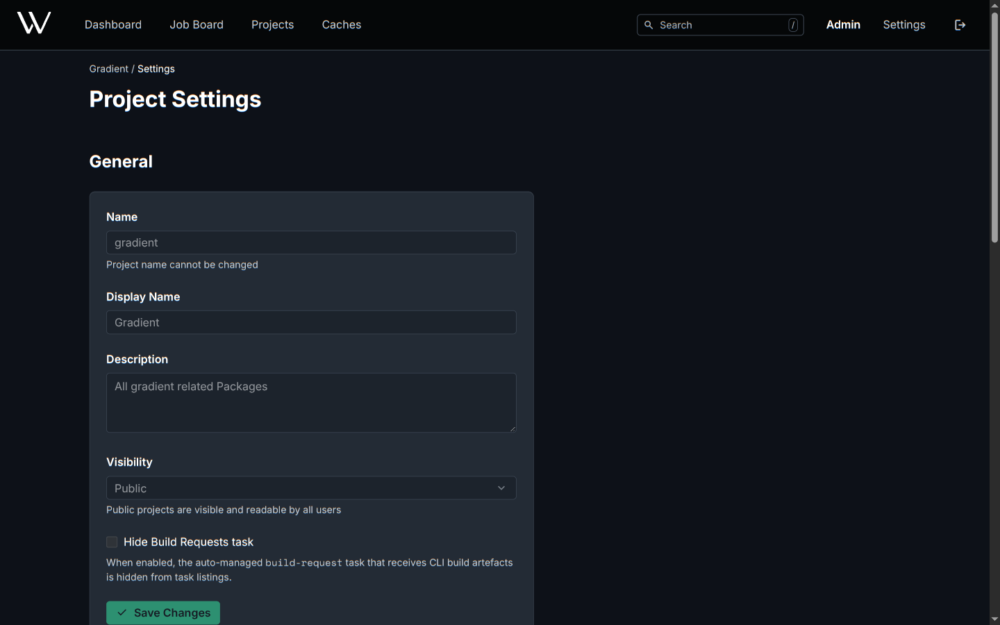
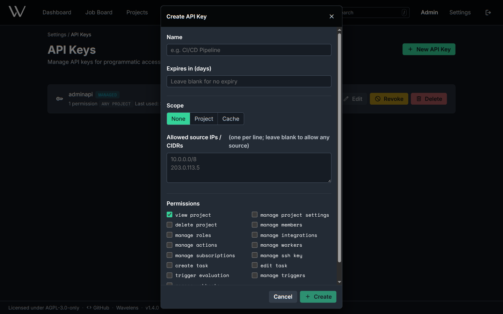
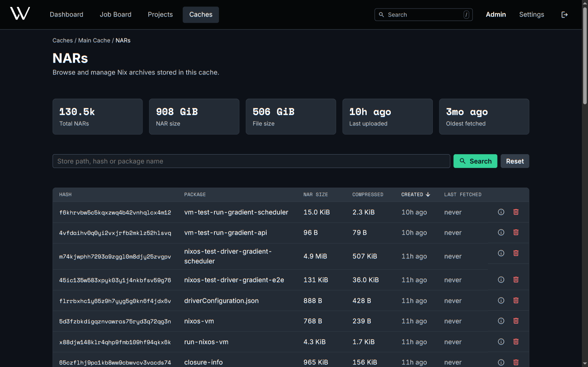

<!--
SPDX-FileCopyrightText: 2026 Wavelens GmbH <info@wavelens.io>
SPDX-License-Identifier: AGPL-3.0-only
-->

# Settings

Settings exist at three levels. The levels are user, project, and cache. Fields of an entity from [Nix declaration](../guides/manage-with-nix.md) show as disabled and carry the hint **This item is managed by the server configuration and cannot be changed here.**

## User Settings

Open **Settings** from the header.

| Page | Content | Actions |
|---|---|---|
| Profile | Username, full name, email | Edit fields. Choose a theme under **Appearance**. **Delete Account** |
| API Keys | Key, its scope and the names of all permissions. The projects and caches that the key can access, the API base URL and an example for `curl` appear in **Access**. Only the Any project scope can provide **Create projects**. A key pinned to a project cannot grant permissions that the owner does not have in that project. | **New API Key**, **Access**, edit, revoke, delete |
| Sessions | All devices currently signed in | **Revoke** a single session |

The theme choice (**System**, **Light**, **Dark**) lives in the browser, not in the account.

Find **Requests** in the user menu in the header. The badge and dashboard show the same count of items that need a user decision. The items include invitations to projects, caches, and teams. Requests to subscribe to caches that belong to the user appear in the list. Requests for team grants on teams that belong to the user also appear in the list. A user can accept, decline, approve, or reject each request in the list.

# Project Settings

Open **Settings** from the project page.

| Section | Content | Actions |
|---|---|---|
| General | Name, display name, description, visibility | Edit. **Hide Build Requests task** removes the task holding `gradient build` evaluations from task lists. The evaluations themselves continue to run |
| More Settings | Links to Workers, Cache Subscriptions, Git host connections, Event notifications | Open each page |
| SSH Key | Public key used for cloning the project's repositories | Copy and add it as a deploy key on the Git host |
| Danger Zone | | **Regenerate Key** invalidates the old key immediately. **Delete Project** removes the project |

Anyone can view every evaluation and build on a public project, signed in or not.

Public projects and caches also appear in lists of projects and caches, search, and the command palette. The server option [`publicListing`](../reference/configuration.md) can turn off those lists. Only members, shared users, subscribers, and users who starred an item can find that item in that case. Stars and direct links still work for everyone.

## Cache Settings

**Settings** on the cache page.

| Field | Effect |
|---|---|
| Priority | Advertised to Nix clients in `nix-cache-info`. Lower values win, default `10` |
| Local Priority | Priority for clients from `services.gradient.http.localIps`. Empty: same as **Priority** |
| Max Storage (GB) | New evaluations wait while all writable caches for the project are below 10 MiB. A path counts toward every cache that holds it and leaves a cache's usage once that cache has not fetched it for `gc.narTtlHours`. `0` is unlimited. This field's value for the instance-wide limit `cache.maxStorageGb` is **Instance limit**. |
| Pull-Through | Nix clients receive paths from the [upstream caches](../concepts/caches.md#pull-through) through the cache. Unchecked: only paths the cache holds |
| Visibility | Public caches hand out paths without credentials |
| Signing Key | Current public keys and their start dates, plus retired keys. Use **Rotate Key** to make a new key pair. See [Signing Key](../concepts/caches.md#signing-key). |

The cache page also includes **Upstream Caches**, **NARs**, **Members**, **Subscriptions** and **Webhooks**.

## Related

- [Members and Roles](members-and-roles.md) covers members, invitations and permissions
- [Caches](../concepts/caches.md) explains upstream caches and substitution order
- [Share a Cache](../guides/share-a-cache.md) shows subscriptions and netrc
