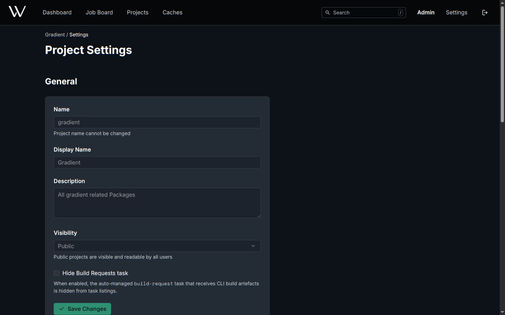
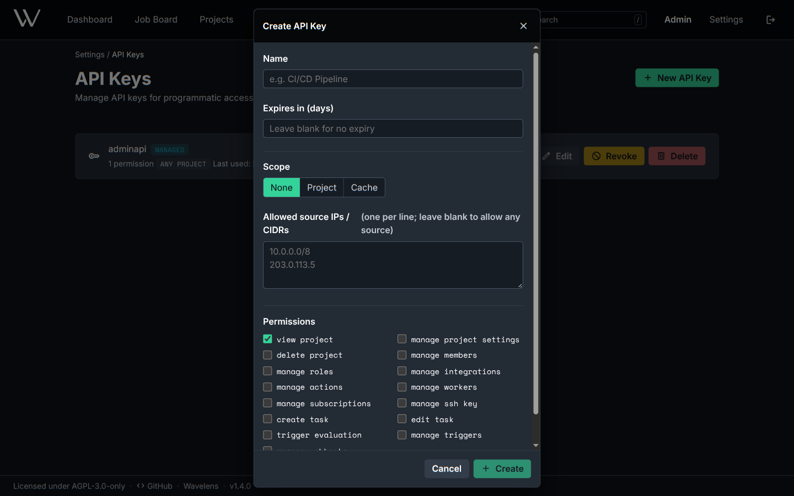
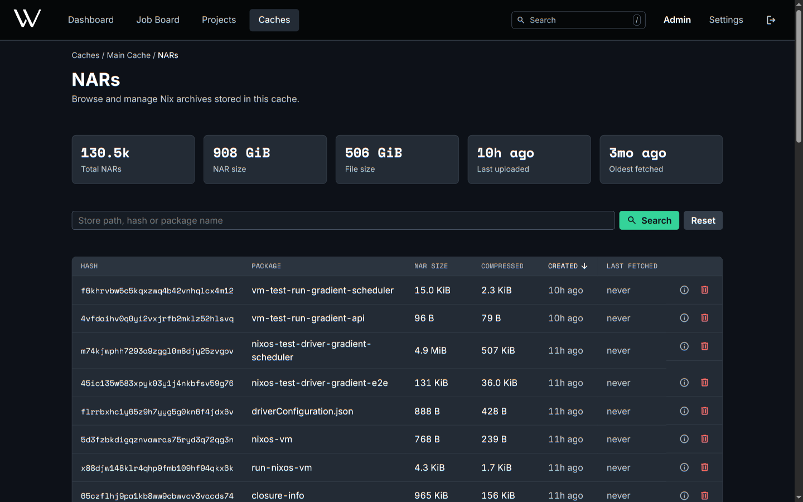

# Settings

Settings exist on three levels: user, project and cache. When an entity comes from a [Nix declaration](../guides/manage-with-nix.md), its fields appear disabled and carry the hint **Managed by Nix**.

## User Settings

Open **Settings** from the header.

| Page | Content | Actions |
|---|---|---|
| Profile | Username, full name, email | Edit fields. Choose a theme under **Appearance**. **Delete Account** |
| API Keys | Keys, each with scope and permissions | **New API Key**, edit, revoke, delete |
| Sessions | All devices currently signed in | **Revoke** a single session |
| My Invites | Pending invitations to projects and caches | Accept or decline |

The theme choice (**System**, **Light**, **Dark**) lives in the browser, not in the account.

# Project Settings

Open **Settings** from the project page.

| Section | Content | Actions |
|---|---|---|
| General | Name, display name, description, visibility | Edit. **Hide Build Requests task** removes the task holding `gradient build` evaluations from task lists. The evaluations themselves continue to run |
| More Settings | Links to Members & Roles, Workers, Cache Subscriptions, Integrations, Webhooks | Open each page |
| SSH Key | Public key used for cloning the project's repositories | Copy and add it as a deploy key on the Git host |
| Danger Zone | | **Regenerate Key** invalidates the old key immediately. **Delete Project** removes the project |

Anyone can view every evaluation and build on a public project, signed in or not.

## Cache Settings

**Settings** on the cache page.

| Field | Effect |
|---|---|
| Priority | Advertised to Nix clients in `nix-cache-info`. Lower values win, default `10` |
| Local Priority | Priority for clients from `services.gradient.http.localIps`. Empty: same as **Priority** |
| Max Storage (GB) | New evaluations wait while every writable cache of the project is down to less than 10 MiB. `0` is unlimited |
| Pull-Through | Nix clients receive paths from the [upstream caches](../concepts/caches.md#pull-through) through the cache. Unchecked: only paths the cache holds |
| Visibility | Public caches hand out paths without credentials |

The cache page also includes **Upstream Caches**, **NARs**, **Members & Roles**, **Subscriptions** and **Webhooks**.

## Related

- [Members and Roles](members-and-roles.md) covers members, invitations and permissions
- [Caches](../concepts/caches.md) explains upstream caches and substitution order
- [Share a Cache](../guides/share-a-cache.md) shows subscriptions and netrc
